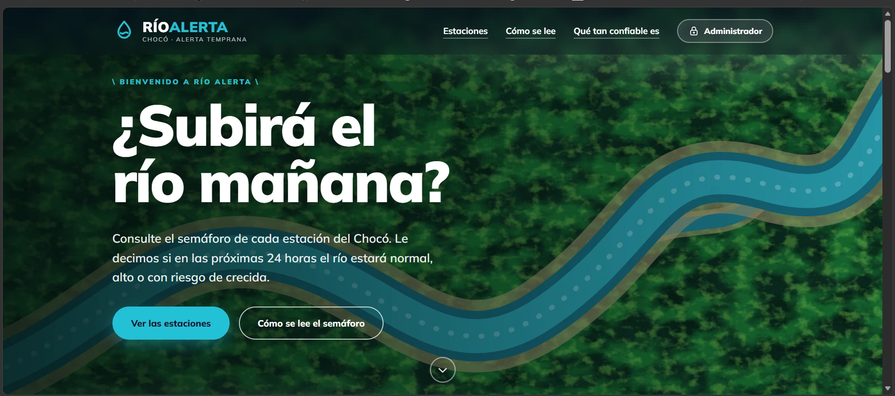
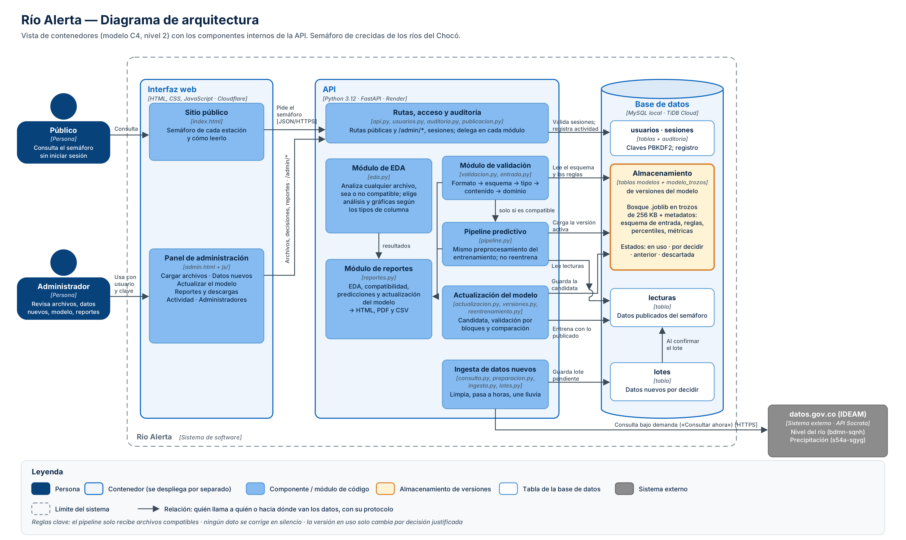
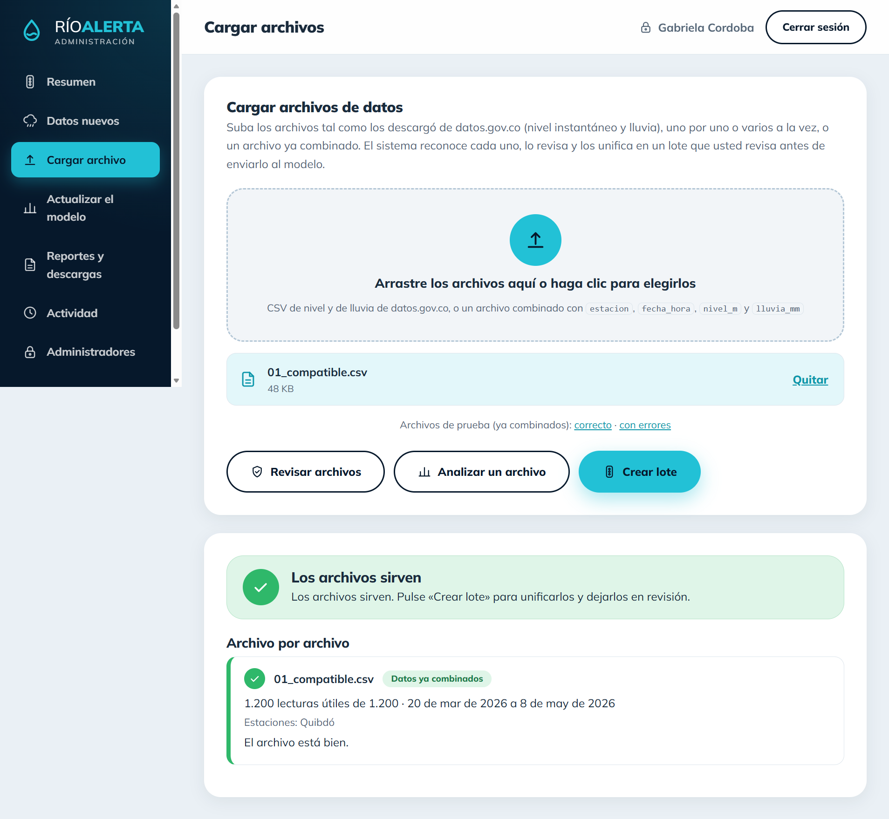
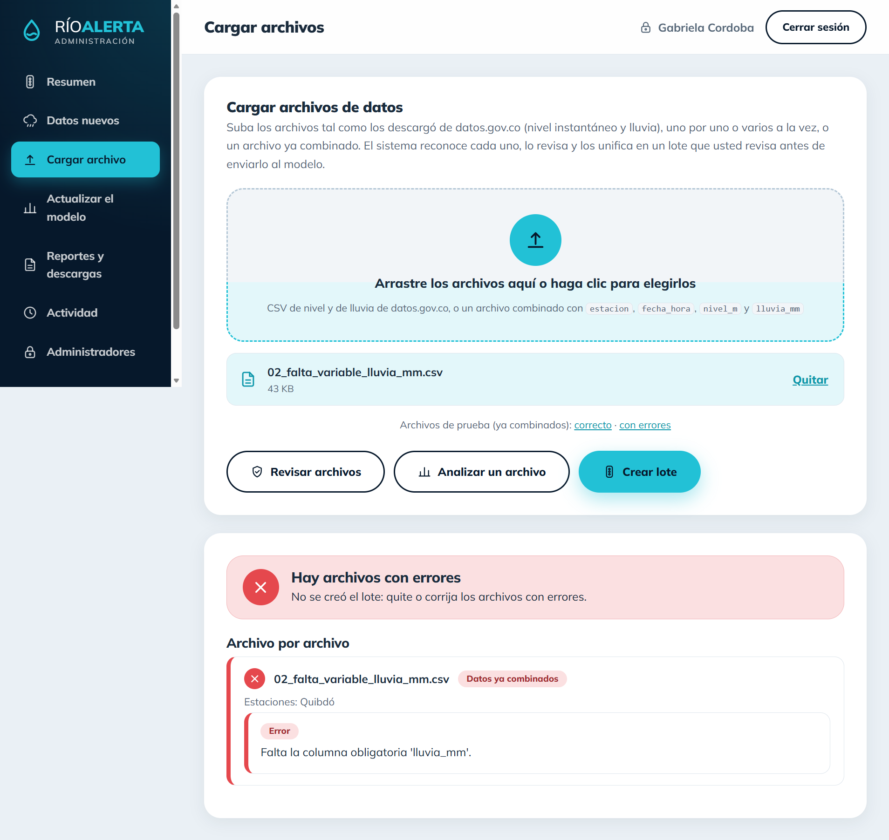

# Río Alerta

Semáforo de crecidas de los ríos del Chocó. Para cada estación de nivel del río, el sistema responde una pregunta: **¿el río llegará a nivel rojo en las próximas 24 horas?**

| Color | El nivel máximo de las próximas 24 horas será... |
|---|---|
| Verde | menor que el percentil 75 de la historia de la estación |
| Amarillo | entre el percentil 75 y el 95 |
| Rojo | el percentil 95 o más: posible crecida |

Un bosque aleatorio lee el nivel del río y la lluvia de las horas y días anteriores y calcula la probabilidad de cada color. Si la probabilidad de rojo llega a 0,40, el semáforo marca rojo. Las estaciones del modelo son Belén (0011047010), Quibdó (0011047020), El Siete (0011027030) y Río Iró (0054027050). Los datos son del IDEAM y se consultan en [datos.gov.co](https://www.datos.gov.co).

El sistema tiene tres partes: la **API** (el programa que hace los cálculos), un **sitio público**, donde cualquier persona ve el semáforo de cada estación, y un **panel de administración**, donde un equipo de administradores sube y revisa archivos, analiza datos, trae datos nuevos, actualiza el modelo, descarga reportes y revisa lo que hace cada persona.



## Estructura de carpetas y cómo funciona cada una

```
proyecto_final/
├── backend/        La API y los módulos que hacen el trabajo
├── interfaz/       El sitio público y el panel de administración
├── modelos/        Las versiones del modelo
├── datos/          Los datos con los que se entrenó y se alimenta el sistema
├── pruebas/        Archivos de prueba y evidencia de los reportes
├── docs/           Documentación, diagrama de arquitectura e imágenes
├── .github/        Aviso periódico para que el servicio no se duerma
└── (archivos sueltos: preparar_datos.py y los cuadernos del análisis y del modelo)
```

### `backend/`: la API

Está hecha con FastAPI. Recibe lo que pide la interfaz, llama al módulo que corresponde y devuelve el resultado. Cada módulo hace una sola tarea:

| Módulo | Qué hace |
|---|---|
| `api.py` | Las rutas de la API, el acceso de administrador y el manejo de errores |
| `publicacion.py` | Las lecturas publicadas (la serie con la que se calcula el semáforo) |
| `validacion.py` | Comprueba que un archivo sirva para el modelo. Lee las reglas de los metadatos del modelo; nunca corrige los datos |
| `entrada.py` | Reconoce qué tipo de archivo se subió (nivel, lluvia o ya combinado), lo lee y lo revisa |
| `eda.py` | Análisis exploratorio automático de cualquier archivo, sirva o no para el modelo |
| `pipeline.py` | Predicciones: aplica el mismo preprocesamiento del entrenamiento, sin reentrenar |
| `reportes.py` | Genera los reportes descargables (compatibilidad, análisis, predicciones y actualización del modelo) |
| `consulta.py`, `consulta_manual.py` | Consultan datos.gov.co, solo cuando un administrador pulsa «Consultar ahora» |
| `preparacion.py`, `ingesta.py`, `lotes.py`, `recomendacion.py` | Limpian los datos nuevos, los pasan a horas, los guardan como un lote pendiente y aconsejan sobre él |
| `reentrenamiento.py`, `actualizacion.py`, `versiones.py` | Entrenan una versión candidata del modelo, la comparan con la que está en uso y guardan las versiones |
| `usuarios.py`, `auditoria.py` | Administradores (claves cifradas, sesiones, bloqueos) y registro de quién hizo qué |
| `base_datos.py`, `migrar_base.py`, `hora.py` | Conexión y tablas de MySQL, copia de la base local a la nube, hora de Colombia |
| `requirements.txt` | Las librerías que necesita |

### `interfaz/`: lo que se ve en el navegador

Es un sitio estático, sin pasos de construcción.

| Contenido | Qué hace |
|---|---|
| `index.html` | El sitio público: el semáforo de cada estación y cómo leerlo |
| `admin.html` | El panel de administración |
| `css/` | Los estilos (`base`, `layout`, `componentes` y `admin`) |
| `js/` | El código de cada pantalla: `publico.js` y `app.js` (sitio público), `admin.js` (panel), `cargar_archivos.js`, `datos_nuevos.js`, `modelo.js`, `reportes.js` y `descargas.js` (módulos del panel), `api.js` (llamadas a la API), `config.js` (a qué API se conecta) |
| `img/` | Imágenes e íconos |
| `ejemplos/` | Dos archivos de ejemplo (correcto y con errores) que el panel ofrece para descargar |

### `modelos/`: las versiones del modelo

`v3/` guarda el bosque (`modelo_semaforo_v3.joblib`) y sus metadatos (`metadatos.json`: variables, esquema de entrada, reglas, métricas). `activo.txt` dice cuál versión se usa. Al iniciar, la API guarda estas versiones en la base de datos; las nuevas que se entrenan desde el panel viven allí.

### `datos/`: los datos

Los archivos descargados de datos.gov.co, la tabla horaria con la que se entrenó el modelo (`datos_horarios.csv`) y los pluviómetros cercanos a cada estación (`pluviometros.json`). La primera vez, la API llena las lecturas publicadas con `datos_horarios.csv`.

### `pruebas/`: las pruebas

- `archivos/`: los 8 archivos de los escenarios obligatorios (compatible, falta una variable, tipos incompatibles, valores faltantes, estación desconocida, columnas adicionales, solo para EDA y datos nuevos).
- `generar_archivos.py`: el script que los vuelve a crear (`python pruebas/generar_archivos.py`).
- `reportes/`: evidencia de los reportes generados por el sistema, en PDF.

### `docs/`: la documentación

- `documentacion_del_proyecto.md`: la documentación completa (arquitectura, esquema de validación, pipeline, actualización del modelo, reportes, API, pruebas con sus resultados, decisiones y limitaciones).
- `diagrama_arquitectura.png`: el diagrama de arquitectura.
- `img/`: las capturas de las pruebas y del panel.

### Otros archivos

| Archivo | Para qué sirve |
|---|---|
| `preparar_datos.py` | Genera la tabla horaria y los pluviómetros a partir de los archivos de datos.gov.co |
| `analisis_inundaciones_choco_v2.ipynb` | Análisis exploratorio original de los datos |
| `modelo_B_semaforo.ipynb` | Entrenamiento y validación original del modelo |
| `Informe_Inundaciones_Choco (1).docx` | Informe del análisis de las inundaciones en el Chocó, de las actividades anteriores |
| `modelo/` | Carpeta del entrenamiento original; el sistema ya no la usa |
| `.github/workflows/mantener_activo.yml` | Visita la API cada 10 minutos para que el servicio gratuito no se duerma |

El diagrama completo de cómo se conectan estas partes:



## Requisitos

- Python 3.12
- Git
- MySQL, la base de datos (sirve la que trae XAMPP)

## 1. Instalar las dependencias

```bash
git clone https://github.com/PalaciosYoisi/proyecto_final.git
cd proyecto_final
pip install -r backend/requirements.txt
```

Crear el archivo `backend/.env` con los datos para conectarse a MySQL, una línea por variable. Este archivo es privado y no se sube a GitHub. Por ejemplo, para el MySQL de XAMPP con su puerto habitual:

```
SEMAFORO_BD_HOST=127.0.0.1
SEMAFORO_BD_PUERTO=3306
SEMAFORO_BD_USUARIO=root
SEMAFORO_BD_CLAVE=
SEMAFORO_BD_NOMBRE=semaforo_alerta
```

Con MySQL encendido, crear la base de datos y el primer administrador (desde la carpeta `backend`):

```bash
cd backend
python base_datos.py
python usuarios.py crear usuario "Nombre Apellido"
```

El último comando muestra la clave inicial una sola vez. Anótela: el sistema pide cambiarla al entrar por primera vez. Otros comandos del mismo archivo: `python usuarios.py restablecer usuario` (nueva clave) y `python usuarios.py listar`.

### Variables de entorno

Se leen del entorno o del archivo `backend/.env`.

| Variable | Para qué sirve | Valor por defecto |
|---|---|---|
| `SEMAFORO_BD_HOST` | Servidor de la base de datos | `127.0.0.1` |
| `SEMAFORO_BD_PUERTO` | Puerto de la base | `3307` |
| `SEMAFORO_BD_USUARIO` | Usuario de la base | `root` |
| `SEMAFORO_BD_CLAVE` | Clave de la base | vacía |
| `SEMAFORO_BD_NOMBRE` | Nombre de la base | `semaforo_alerta` |
| `SEMAFORO_BD_SSL` | `si` para bases en la nube, que exigen conexión segura | `no` |
| `SEMAFORO_MODELOS` | Carpeta con las versiones del modelo | `modelos/` |
| `SEMAFORO_ORIGENES` | Direcciones web que pueden llamar a la API, separadas por comas | todas |
| `SEMAFORO_TAM_MAX_MB` | Tamaño máximo de un archivo subido, en MB | `60` |
| `SEMAFORO_TAM_MAX_CRUDO_MB` | Tamaño máximo de un archivo crudo de datos.gov.co, en MB | `400` |

## 2. Iniciar la API

Desde la carpeta `backend`:

```bash
uvicorn api:app --reload
```

La API queda funcionando en `http://127.0.0.1:8000`. En `http://127.0.0.1:8000/docs` se pueden ver y probar todas sus operaciones. La primera vez que arranca, carga sola los datos del río y el modelo entrenado.

## 3. Iniciar la interfaz

Sin cerrar la API, abrir otra terminal y, desde la carpeta `interfaz`:

```bash
python -m http.server 5500
```

- Sitio público: `http://localhost:5500/index.html`
- Panel de administración: `http://localhost:5500/admin.html` (se entra con el usuario creado en la instalación)

Cuando la página se abre desde `localhost`, usa la API local; en cualquier otra dirección usa la API publicada (se configura en `interfaz/js/config.js`).

## 4. Ejecutar una prueba completa

Esta prueba recorre todo el sistema. Los archivos de prueba están en `pruebas/archivos/`.

1. Entrar a `admin.html` con el usuario creado y cambiar la clave inicial.
2. En **Cargar archivos**, elegir `01_compatible.csv` y pulsar **Revisar archivos**: sale en verde, porque el archivo cumple todo lo que el modelo necesita.
3. Pulsar **Analizar un archivo** para ver el análisis exploratorio (EDA): un resumen de los datos, qué tan completos están, sus estadísticas y gráficas.
4. En **Reportes para descargar**, descargar el reporte de compatibilidad y el de predicciones.
5. Quitar el archivo, elegir `02_falta_variable_lluvia_mm.csv` y pulsar **Revisar archivos**: sale en rojo, explica que falta la columna de lluvia (`lluvia_mm`) y no deja hacer predicciones.
6. Repetir con los archivos `03` a `07`. Con `07_solo_para_eda_emergencias.csv`, usar también **Analizar un archivo**: no sirve para predecir, pero sí se puede analizar.
7. En **Datos nuevos**, pulsar **Consultar ahora**, abrir el grupo de datos nuevos (lote) que aparece y confirmarlo. Esto necesita internet. En una instalación nueva también se puede subir `08_nuevos_datos_reales.csv` en **Cargar archivos** y pulsar **Crear lote**.
8. En **Actualizar el modelo**, pulsar **Actualizar el modelo** (o **Entrenar de todos modos**) y esperar a que se llene la barra de avance.
9. En la tabla de versiones, pulsar **Comparar y decidir**, ver si la versión nueva es mejor que la actual, descargar el reporte y decidir, escribiendo el porqué.
10. En **Reportes y descargas**, ver un reporte y descargarlo en PDF.
11. En **Actividad**, comprobar que todo lo anterior quedó anotado con el nombre de quien lo hizo.
12. En `http://127.0.0.1:8000/docs`, probar `GET /modelo/activo`, que muestra los datos del modelo en uso.

Lo que debe pasar con cada archivo de prueba:

| Archivo | Resultado esperado |
|---|---|
| `01_compatible.csv` | Sirve (verde) |
| `02_falta_variable_lluvia_mm.csv` | No sirve: le falta la columna de lluvia |
| `03_tipos_incompatibles.csv` | No sirve: tiene texto donde va el nivel y fechas mal escritas |
| `04_valores_faltantes_en_nivel.csv` | Sirve con un aviso: al 30 % de las filas le falta el nivel |
| `05_estacion_desconocida.csv` | No sirve: trae una estación que el modelo no conoce |
| `06_columnas_adicionales.csv` | Sirve con un aviso: trae 3 columnas de más, que se ignoran |
| `07_solo_para_eda_emergencias.csv` | No sirve para predecir (es de otro tema), pero sí se puede analizar |
| `08_nuevos_datos_reales.csv` | Sirve con un aviso: faltan 14 horas de datos |

Así se ven los dos primeros resultados:

 

Los resultados de los ocho escenarios, con sus capturas, y las demás explicaciones (esquema de validación, pipeline, actualización del modelo, reportes, API, decisiones y limitaciones) están en [docs/documentacion_del_proyecto.md](docs/documentacion_del_proyecto.md).

## Despliegue

El sistema se publica con servicios gratuitos: la **API** en Render (carpeta `backend`), la **base de datos** en TiDB Cloud (se pasa lo local con `python migrar_base.py`) y el **sitio** en Cloudflare (carpeta `interfaz`). En la nube se usa `SEMAFORO_BD_SSL=si` y `SEMAFORO_ORIGENES` con la dirección del sitio. Como Render duerme el servicio gratuito tras 15 minutos sin visitas, el flujo `.github/workflows/mantener_activo.yml` visita `/salud` cada 10 minutos. Más detalles en la sección «Despliegue» de la documentación.
