# Río Alerta: documentación del proyecto

Semáforo de crecidas de los ríos del Chocó. Este documento reúne todo lo necesario para entender, ejecutar, probar y explicar el proyecto: qué hace, cómo está organizado, cómo se valida un archivo, cómo se actualiza el modelo, qué reportes genera, cómo se probó y qué limitaciones tiene. El diagrama de arquitectura está en `docs/diagrama_arquitectura.png` y la evidencia de los reportes en `pruebas/reportes/`.

> Las imágenes están en `docs/img/`. Todos los resultados de las pruebas son los que salieron al ejecutarlas, sin ajustes.

## Contenido

1. [Qué es el proyecto](#1-qué-es-el-proyecto)
2. [Arquitectura](#2-arquitectura)
3. [Organización del repositorio](#3-organización-del-repositorio)
4. [Instalación y ejecución en local](#4-instalación-y-ejecución-en-local)
5. [El panel de administración, módulo por módulo](#5-el-panel-de-administración-módulo-por-módulo)
6. [Esquema del modelo y validación de archivos](#6-esquema-del-modelo-y-validación-de-archivos)
7. [Análisis exploratorio (EDA) automático](#7-análisis-exploratorio-eda-automático)
8. [Pipeline y predicciones](#8-pipeline-y-predicciones)
9. [Datos nuevos, actualización del modelo y versiones](#9-datos-nuevos-actualización-del-modelo-y-versiones)
10. [Reportes](#10-reportes)
11. [API](#11-api)
12. [Seguridad y trazabilidad](#12-seguridad-y-trazabilidad)
13. [Pruebas](#13-pruebas)
14. [Despliegue](#14-despliegue)
15. [Decisiones de arquitectura](#15-decisiones-de-arquitectura)
16. [Limitaciones conocidas](#16-limitaciones-conocidas)
17. [Equipo y trazabilidad del repositorio](#17-equipo-y-trazabilidad-del-repositorio)
18. [Dónde se cumple cada requisito del enunciado](#18-dónde-se-cumple-cada-requisito-del-enunciado)

---

## 1. Qué es el proyecto

Para cada estación de nivel del río, el sistema responde una pregunta: **¿el río llegará a nivel rojo en las próximas 24 horas?**

| Color | El nivel máximo de las próximas 24 horas será... |
|---|---|
| Verde | menor que el percentil 75 de la historia de la estación |
| Amarillo | entre el percentil 75 y el 95 |
| Rojo | el percentil 95 o más: posible crecida |

Un bosque aleatorio lee el nivel del río y la lluvia de las horas y días anteriores y calcula la probabilidad de cada color. Si la probabilidad de rojo llega a **0,40**, el semáforo marca rojo.

**Estaciones del modelo**

| Código | Estación | Municipio |
|---|---|---|
| 0011047010 | Belén | Quibdó |
| 0011047020 | Quibdó | Quibdó |
| 0011027030 | El Siete | Carmen de Atrato |
| 0054027050 | Río Iró | Río Iró |

**Datos.** Provienen del IDEAM y se consultan en [datos.gov.co](https://www.datos.gov.co): nivel instantáneo del río (conjunto `bdmn-sqnh`) y precipitación (conjunto `s54a-sgyg`). Los datos se pasan a horas y a cada estación se le asigna la lluvia promedio de hasta 3 pluviómetros a menos de 25 km. El modelo se entrenó con datos del 1 de enero de 2022 al 24 de octubre de 2026.

**Quiénes lo usan**

- **El público** ve el semáforo de cada estación y cómo leerlo, sin iniciar sesión.
- **Un equipo de administradores** sube y revisa archivos, analiza datos, trae datos nuevos de datos.gov.co, actualiza el modelo, descarga reportes y revisa quién hizo qué.

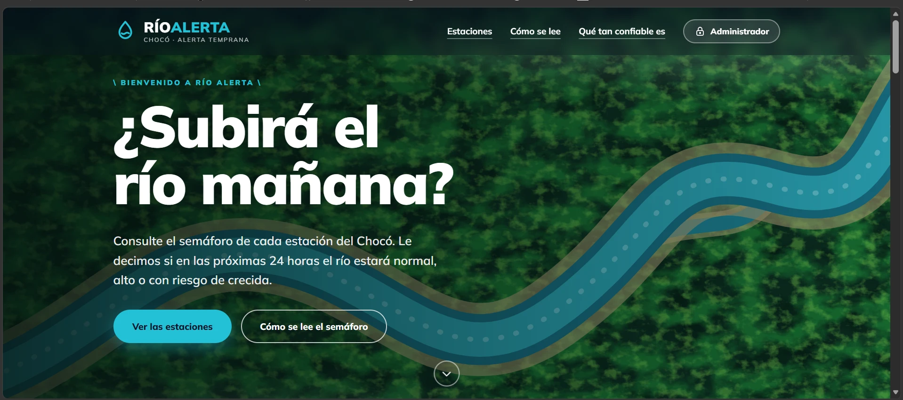

**El modelo en una mirada (versión v3, en uso)**

| Aspecto | Valor |
|---|---|
| Algoritmo | Bosque aleatorio (`RandomForestClassifier`): 300 árboles, profundidad máxima 8, mínimo 10 ejemplos por hoja, clases balanceadas |
| Variable objetivo | `color_semaforo_proximas_24h` (Verde, Amarillo, Rojo), con percentiles 75 y 95 de cada estación |
| Variables | 39: nivel como percentil, cambios del nivel (1, 3, 6, 12, 24 y 48 h), máximos recientes (24 h, 72 h, 7 días), lluvia acumulada, hora, época del año y estación |
| Entrenamiento | 15.542 ejemplos (una hora de cada 3), entrenado el 27 de octubre de 2026 |
| Validación | Por bloques de tiempo: cada bloque se predice solo con lo anterior |
| Métrica principal | F1 del rojo = **0,597** |

Métricas de validación de v3 frente a dos reglas simples (se guardan en los metadatos del modelo):

| Método | Color acertado | Rojos detectados | Alertas rojas correctas | F1 del rojo | Rojos no detectados | Falsas alarmas |
|---|---|---|---|---|---|---|
| **Bosque aleatorio (v3)** | 0,741 | 0,502 | 0,735 | **0,597** | 610 | 222 |
| Regla: nivel de hoy | 0,773 | 0,371 | 0,962 | 0,535 | 771 | 18 |
| Regla: máximo de 24 h | 0,703 | 0,526 | 0,528 | 0,527 | 581 | 576 |

El modelo supera a las dos reglas simples en la métrica principal (F1 del rojo).

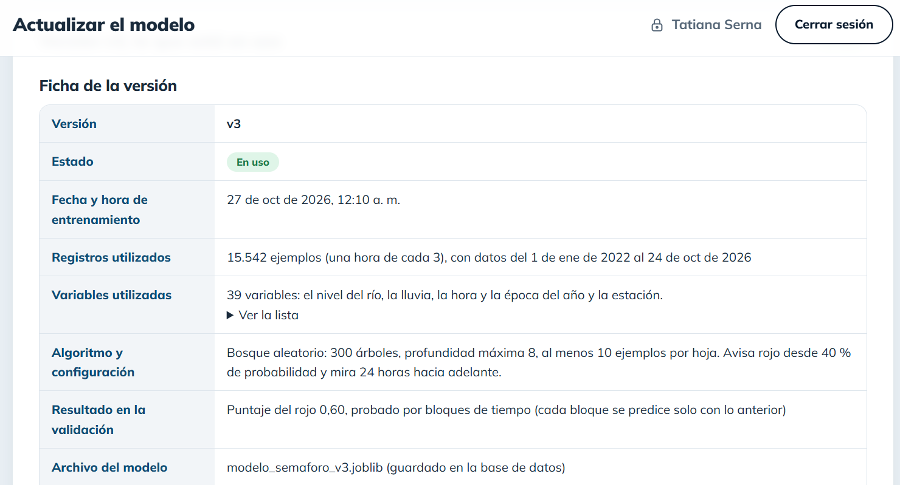

---

## 2. Arquitectura

Diagrama de arquitectura (modelo C4, nivel 2, con los componentes internos de la API):

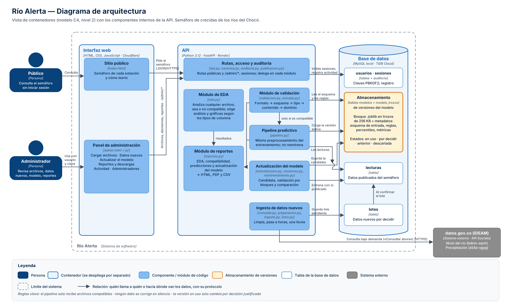

Misma arquitectura en un diagrama editable (se ve en GitHub):

<details>
<summary>Ver el diagrama editable</summary>

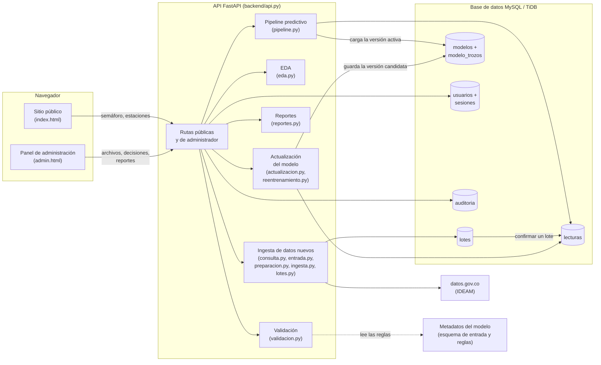

</details>

**Componentes del enunciado y dónde viven**

| Componente (sección 2 del enunciado) | Dónde está |
|---|---|
| 1. Interfaz web | `interfaz/`: sitio público (`index.html`) y panel (`admin.html`) con su código en `js/` |
| 2. API | `backend/api.py` (FastAPI): rutas, acceso de administrador y manejo de errores |
| 3. Módulo de validación | `backend/validacion.py`, que lee las reglas del esquema guardado en los metadatos del modelo |
| 4. Módulo de EDA | `backend/eda.py`: decide qué analizar según los tipos de columna que encuentra |
| 5. Pipeline predictivo | `backend/pipeline.py`: mismo preprocesamiento del entrenamiento, sin reentrenar |
| 6. Módulo de reportes | `backend/reportes.py` y `interfaz/js/reportes.js` |
| 7. Módulo de actualización | `backend/actualizacion.py`, `reentrenamiento.py`, `versiones.py`, `recomendacion.py` |
| Almacenamiento de versiones | Tablas `modelos` y `modelo_trozos` en la base de datos |

**Flujos principales**

1. **Ver el semáforo (público).** La API toma las lecturas publicadas de cada estación, calcula las variables con el pipeline, aplica la versión activa del modelo y devuelve el color y la probabilidad.
2. **Revisar un archivo (administrador).** El archivo se reconoce y se lee como texto (`entrada.py`), se valida contra el esquema (`validacion.py`) y, solo si es compatible, se puede predecir. Siempre se puede analizar con el EDA.
3. **Datos nuevos.** La consulta a datos.gov.co o un archivo subido pasan por la misma ingesta: limpieza, paso a horas, unión con la lluvia y recomendación. Quedan como un **lote pendiente**; un administrador decide si pasa a lo publicado.
4. **Actualizar el modelo.** Con lo publicado se entrena en segundo plano una **versión candidata**, se valida por bloques de tiempo y se compara con la versión en uso. Una persona decide, con justificación escrita.

---

## 3. Organización del repositorio

| Carpeta o archivo | Qué contiene |
|---|---|
| `backend/` | La API y sus módulos (ver tabla siguiente) |
| `interfaz/` | El sitio público y el panel, con estilos (`css/`), código (`js/`), imágenes (`img/`) y archivos de ejemplo (`ejemplos/`) |
| `modelos/` | Versiones del modelo sembradas desde disco (`v3/`: bosque y metadatos) y `activo.txt`. Después se guardan en la base de datos |
| `datos/` | Datos de datos.gov.co, la tabla horaria con la que se entrenó (`datos_horarios.csv`) y los pluviómetros por estación (`pluviometros.json`) |
| `pruebas/` | Los 8 archivos de los escenarios obligatorios (`archivos/`) y el script que los genera (`generar_archivos.py`) |
| `docs/` | Esta documentación y las imágenes de evidencia (`img/`) |
| `preparar_datos.py` | Genera la tabla horaria y los pluviómetros a partir de los archivos de datos.gov.co |
| `analisis_inundaciones_choco_v2.ipynb`, `modelo_B_semaforo.ipynb` | Análisis exploratorio y entrenamiento original del modelo |
| `reentrenar_modelo.ipynb` | Cuaderno del reentrenamiento |
| `.github/workflows/mantener_activo.yml` | Visita la API cada 10 minutos para que el servicio gratuito no se duerma |

**Módulos del backend**

| Módulo | Para qué sirve |
|---|---|
| `api.py` | Rutas, acceso de administrador, manejo de errores |
| `publicacion.py` | Lecturas publicadas (tabla `lecturas`) y semáforo de cada estación |
| `validacion.py` | Compara un archivo con el esquema del modelo y devuelve el diagnóstico |
| `entrada.py` | Reconoce el tipo de archivo subido (nivel, lluvia o combinado), lo lee y lo revisa |
| `eda.py` | Análisis exploratorio automático |
| `pipeline.py` | Predicciones con el preprocesamiento del entrenamiento |
| `reportes.py` | Reportes HTML descargables y archivos CSV combinados |
| `consulta.py`, `consulta_manual.py` | Consulta a datos.gov.co (solo cuando un administrador pulsa «Consultar ahora») |
| `preparacion.py`, `ingesta.py`, `lotes.py`, `recomendacion.py` | Preparar lo recibido, guardarlo como lote y aconsejar sobre él |
| `reentrenamiento.py`, `actualizacion.py`, `versiones.py` | Entrenar una versión candidata, seguir su avance, compararla y guardarla |
| `usuarios.py`, `auditoria.py` | Administradores, sesiones y registro de actividad |
| `base_datos.py`, `migrar_base.py`, `hora.py` | Conexión y tablas, migración de local a la nube, hora de Colombia |

---

## 4. Instalación y ejecución en local

Se necesita Python 3.12, Git y un servidor MySQL (por ejemplo, el de XAMPP).

**1. Clonar el repositorio**

```bash
git clone https://github.com/PalaciosYoisi/proyecto_final.git
cd proyecto_final
```

**2. Instalar las dependencias**

```bash
pip install -r backend/requirements.txt
```

Las dependencias son: `fastapi`, `uvicorn`, `python-multipart`, `pandas`, `numpy`, `scikit-learn`, `joblib`, `matplotlib`, `openpyxl` y `pymysql`.

**3. Encender MySQL y configurar la conexión.** Los datos de conexión se escriben en `backend/.env`, una línea por variable. Este archivo no se sube a GitHub. Ejemplo para el MySQL de XAMPP:

```
SEMAFORO_BD_HOST=127.0.0.1
SEMAFORO_BD_PUERTO=3306
SEMAFORO_BD_USUARIO=root
SEMAFORO_BD_CLAVE=
SEMAFORO_BD_NOMBRE=semaforo_alerta
```

**4. Crear la base y las tablas** (desde `backend`)

```bash
cd backend
python base_datos.py
```

**5. Crear un administrador.** El comando muestra su clave inicial una sola vez, y esa persona debe cambiarla al entrar:

```bash
python usuarios.py crear usuario "Nombre Apellido"
```

Otros comandos: `python usuarios.py restablecer usuario` y `python usuarios.py listar`.

**Variables de entorno** (se leen del entorno o de `backend/.env`)

| Variable | Para qué sirve | Valor por defecto |
|---|---|---|
| `SEMAFORO_BD_HOST` | Servidor de la base de datos | `127.0.0.1` |
| `SEMAFORO_BD_PUERTO` | Puerto de la base | `3307` |
| `SEMAFORO_BD_USUARIO` | Usuario de la base | `root` |
| `SEMAFORO_BD_CLAVE` | Clave de la base | vacía |
| `SEMAFORO_BD_NOMBRE` | Nombre de la base | `semaforo_alerta` |
| `SEMAFORO_BD_SSL` | `si` para bases en la nube, que exigen conexión segura | `no` |
| `SEMAFORO_MODELOS` | Carpeta con las versiones del modelo | `modelos/` |
| `SEMAFORO_ORIGENES` | Direcciones web que pueden llamar a la API, separadas por comas | todas |
| `SEMAFORO_TAM_MAX_MB` | Tamaño máximo de un archivo subido, en MB | `60` |
| `SEMAFORO_TAM_MAX_CRUDO_MB` | Tamaño máximo de un archivo crudo de datos.gov.co, en MB | `400` |

**Iniciar el sistema.** Con MySQL encendido, en dos terminales.

La API, desde `backend`:

```bash
uvicorn api:app --reload
```

Queda en `http://127.0.0.1:8000`; su documentación interactiva está en `http://127.0.0.1:8000/docs`. La primera vez que se usa, la API llena las lecturas publicadas con los datos de `datos/datos_horarios.csv` y guarda en la base la versión del modelo de `modelos/`.

La interfaz, desde `interfaz`:

```bash
python -m http.server 5500
```

- Sitio público: `http://localhost:5500/index.html`
- Panel de administración: `http://localhost:5500/admin.html`

Cuando la página se abre desde `localhost`, usa la API local; en cualquier otra dirección usa la API publicada (se configura en `interfaz/js/config.js`).

---

## 5. El panel de administración, módulo por módulo

**Acceso.** Cada administrador entra con su usuario y su clave. En el primer ingreso debe elegir una clave propia de al menos 8 caracteres.

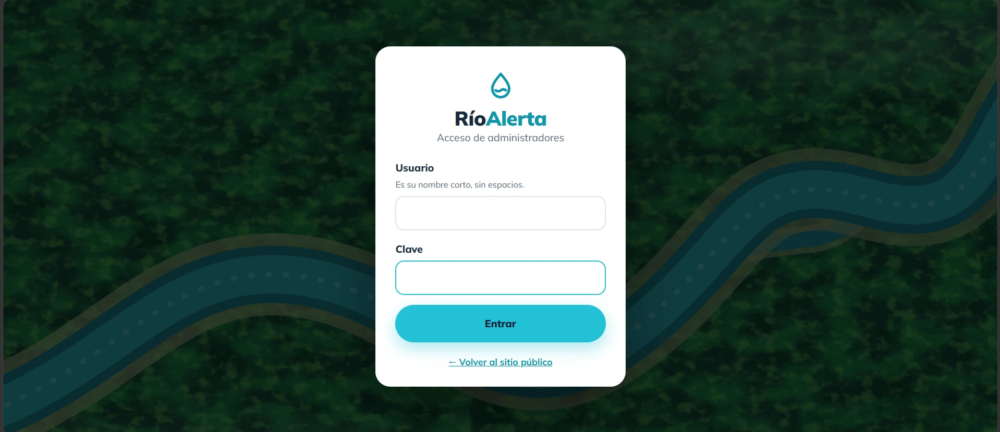
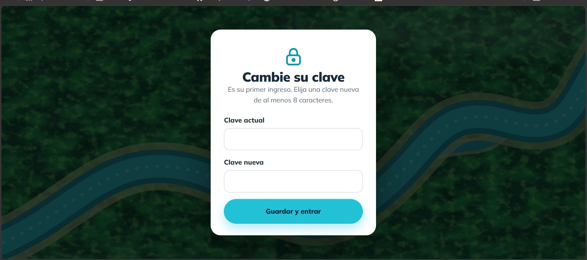

**Resumen.** Estaciones publicadas, cuántas están en rojo, el último dato recibido, la versión del modelo en uso y el estado de cada estación tal como lo ve el público.

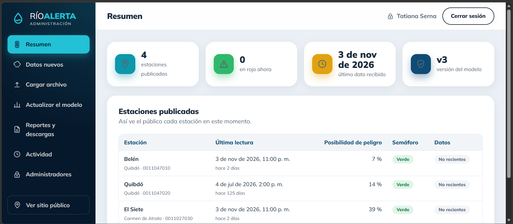

**Datos nuevos.** El botón **Consultar ahora** trae de datos.gov.co lo más reciente y lo deja como un lote pendiente. La tabla muestra cada lote, su origen, estado, periodo y quién decidió. Al abrir un lote se ven sus datos diarios, las lecturas marcadas con su justificación y la recomendación del sistema (agregar, revisar con cuidado o rechazar).

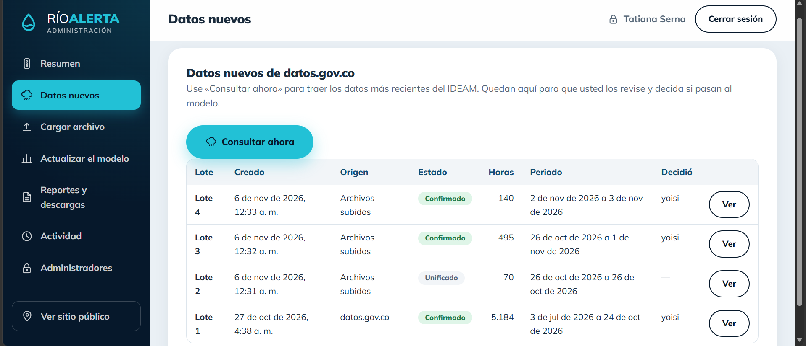

**Cargar archivos.** Se suben archivos CSV o Excel (los de datos.gov.co o uno ya combinado con `estacion`, `fecha_hora`, `nivel_m` y `lluvia_mm`). Tres acciones:

- **Revisar archivos:** reconoce cada archivo y muestra, archivo por archivo, errores y advertencias.
- **Analizar un archivo:** ejecuta el EDA sobre un archivo, sea o no compatible.
- **Crear lote:** unifica los archivos y los deja en revisión.

Debajo hay una tarjeta «Reportes para descargar» para obtener los reportes del archivo elegido. El panel ofrece además dos archivos de ejemplo (correcto y con errores).

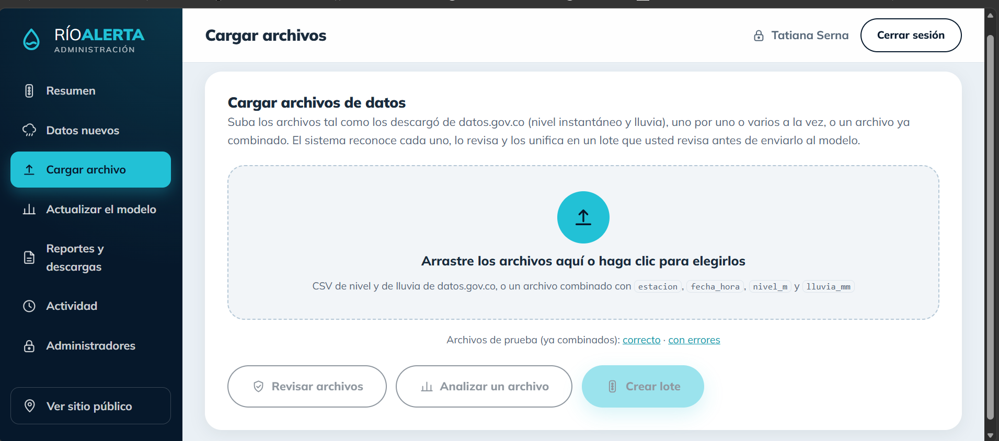

**Actualizar el modelo.** Tres partes: el consejo sobre si conviene actualizar (con las razones), el botón para entrenar una versión candidata y la tabla de versiones, donde se compara y se decide. Ver [sección 9](#9-datos-nuevos-actualización-del-modelo-y-versiones).

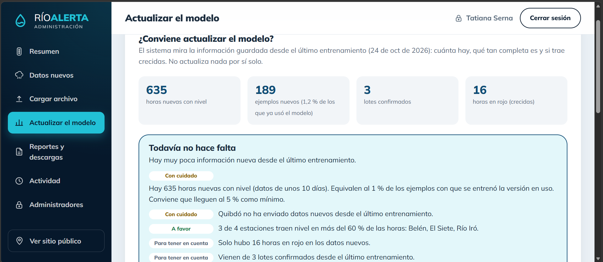
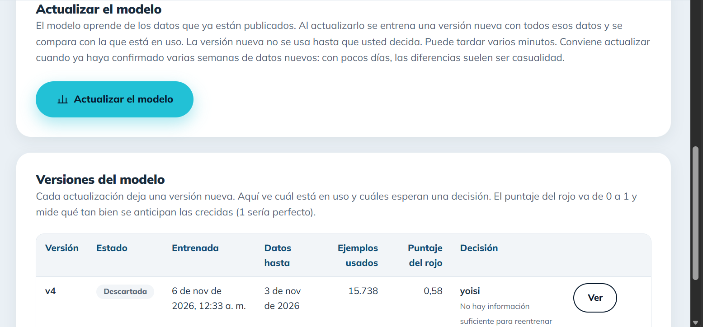

**Reportes y descargas.** Un solo módulo para ver, generar y descargar los reportes y los datos. Ver [sección 10](#10-reportes).

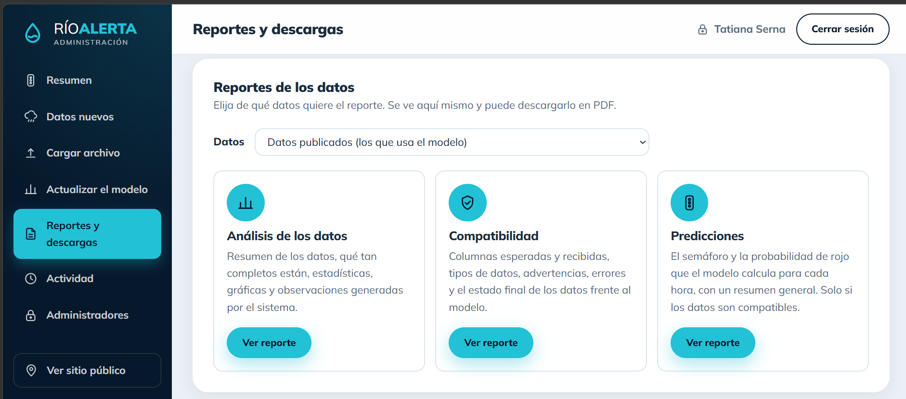

**Actividad.** Registro de quién hizo qué y cuándo, filtrable por persona y por acción. No se puede editar.

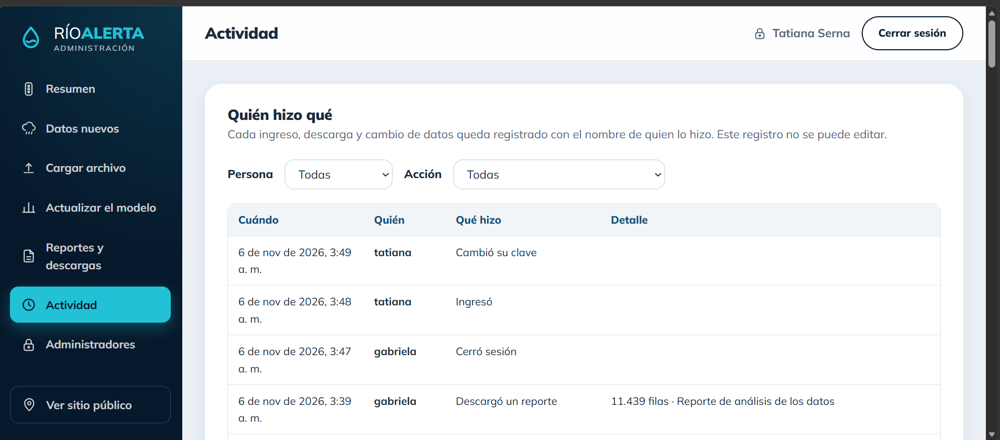

**Administradores.** Lista de administradores y su estado. Otro administrador puede desbloquear a quien se haya bloqueado o restablecerle la clave (se genera una clave temporal que debe cambiar al ingresar).

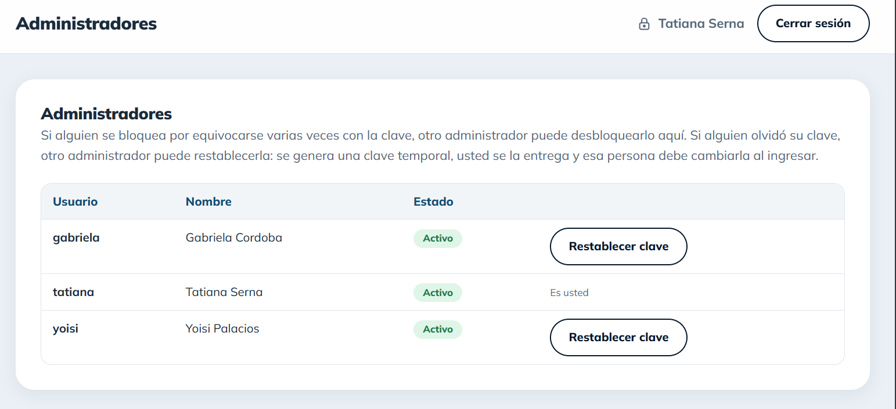

---

## 6. Esquema del modelo y validación de archivos

### Dónde están las reglas

Las reglas **no están escritas en la interfaz ni en el código de validación**. Se leen del esquema de entrada guardado en los metadatos del modelo (`modelos/v3/metadatos.json`, campo `entrada`). `validacion.py` solo las aplica. Si se entrena otra versión, sus metadatos traen su propio esquema.

**Metadatos que se conservan por versión** (secciones 4 y 9 del enunciado)

| Metadato | Ejemplo en v3 |
|---|---|
| Versión, fecha y hora de entrenamiento | `v3`, 27 de octubre de 2026 |
| Algoritmo y configuración | Bosque aleatorio, 300 árboles, profundidad 8, umbral de probabilidad de rojo 0,40, horizonte 24 h |
| Registros utilizados y periodo de datos | 15.542 ejemplos; 2022-01-01 a 2026-10-24 |
| Variable objetivo | `color_semaforo_proximas_24h`, categórica (Verde, Amarillo, Rojo) |
| Métrica principal y métricas de validación | F1 del rojo 0,597 y las seis métricas de la sección 1 |
| Variables usadas y variables excluidas | 39 variables; excluidas: `municipio`, `nombre_estacion`, `n_pluviometros`, `objetivo_percentil`, `color_objetivo` |
| Estaciones válidas y referencia de percentiles por estación | Las 4 estaciones del modelo |
| Archivo del modelo | `modelo_semaforo_v3.joblib` (guardado en la base de datos) |
| Estado | activo, candidato o histórico |
| Esquema de entrada | Ver tabla siguiente |

**Esquema de entrada** (lo que debe traer un archivo para predecir)

| Columna | Tipo | ¿Admite vacíos? | Reglas |
|---|---|---|---|
| `estacion` | Categórica (texto) | No | Solo estas categorías: `0011047010`, `0011047020`, `0011027030`, `0054027050`. Una categoría desconocida **rechaza el archivo** |
| `fecha_hora` | Fecha y hora | No | Formato `AAAA-MM-DD HH:MM:SS`, hora en punto. Las horas ausentes se tratan como dato faltante |
| `nivel_m` | Numérico | Sí | Mayor que 0 y dentro de un rango plausible por estación. La hora a predecir debe tener nivel |
| `lluvia_mm` | Numérico | Sí | Entre 0 y 500 mm por hora |

Además, se necesitan al menos **168 horas de historia por estación** para predecir (lo ideal son 30 días).

### Niveles de validación y estados

| Nivel (sección 3 del enunciado) | Reglas | Qué comprueba | Severidad |
|---|---|---|---|
| **Esquema** | `ESQ-001` | Falta una columna obligatoria | Error |
| | `ESQ-002` | Columnas adicionales que el modelo no usa (se ignoran) | Advertencia |
| **Tipo de dato** | `TIP-001` | Un valor numérico trae texto o formato distinto (los decimales van con punto) o infinitos | Error |
| | `TIP-002` | Una fecha no tiene el formato esperado | Error |
| **Contenido** | `CON-001` | Una columna que no admite vacíos trae filas sin dato | Error |
| | `CON-002` | Categoría que el modelo no conoce (por ejemplo, una estación nueva) | Error |
| | `CON-003` | Valores vacíos en una variable que los admite (se informa la cantidad y el porcentaje) | Advertencia |
| | `CON-004` | Filas duplicadas (misma estación y misma hora): el sistema no decide cuál conservar | Error |
| | `CON-005` | Horas faltantes entre la primera y la última de cada estación | Advertencia |
| **Reglas de dominio** | `DOM-001` | Filas que no están en una hora en punto | Error |
| | `DOM-002` | Un valor no cumple el mínimo (por ejemplo, el nivel debe ser mayor que 0) | Error |
| | `DOM-003` | Un valor fuera del rango definido (por ejemplo, lluvia entre 0 y 500) | Error |
| | `DOM-004` | Nivel fuera del rango físico plausible de su estación | Error |

Cada hallazgo indica la variable, qué esperaba el modelo, qué encontró, cuántas filas afecta y ejemplos de filas (la fila 1 del archivo es el encabezado).

**Estados del archivo**

| Estado | Significado | ¿Se pueden generar predicciones? |
|---|---|---|
| Compatible | Cumple todo | Sí |
| Compatible con advertencias | Se puede procesar, pero hay situaciones que el usuario debe conocer | Sí |
| Incompatible | Hay al menos un error | **No**: la ruta de predicción responde 422 con el diagnóstico |

**El sistema nunca corrige los datos en silencio.** Solo informa. El usuario corrige el archivo y lo carga de nuevo para una nueva validación.

**Dos capas de revisión al subir un archivo.** En **Cargar archivos**, primero `entrada.py` reconoce el formato (si no reconoce las columnas de datos.gov.co ni las del archivo combinado, lo rechaza con un mensaje que lista las columnas encontradas); después `validacion.py` compara los datos con el esquema del modelo.

---

## 7. Análisis exploratorio (EDA) automático

El módulo `eda.py` analiza **cualquier tabla, sea o no compatible con el modelo**. No usa una plantilla fija: primero detecta el tipo de cada columna (numérica, categórica, temporal, código u otra) y solo calcula los análisis y gráficas que tienen sentido para esos tipos.

| Qué calcula | Detalle |
|---|---|
| Tamaño | Filas y columnas |
| Tipos de variable | Numéricas, categóricas, temporales y otras |
| Calidad | Valores faltantes por variable y porcentaje; filas duplicadas |
| Estadísticas descriptivas | Para variables numéricas |
| Frecuencias | Frecuencias y proporciones para categóricas (hasta 20 categorías) |
| Valores atípicos | Criterio documentado: 1,5 × rango intercuartílico (Tukey) |
| Variables temporales | Periodo cubierto, días cubiertos e interrupciones |
| Relaciones | Correlación de Spearman entre variables numéricas, con la aclaración de que son **asociaciones, nunca causas** |
| Gráficas | Histogramas, barras, boxplots, dispersión y correlaciones, según los tipos encontrados |
| Observaciones | Frases generadas solo con lo que se calculó |

Por rendimiento, sobre 100.000 filas las gráficas y correlaciones usan una muestra.

Se puede ejecutar desde **Cargar archivos → Analizar un archivo** o desde el módulo **Reportes y descargas** (sobre los datos publicados o un lote).

---

## 8. Pipeline y predicciones

`pipeline.py` une el bosque y los metadatos de una versión y aplica a datos nuevos **exactamente el mismo preprocesamiento del entrenamiento**.

- **No reentrena nada** al predecir: el modelo se carga de un archivo persistido (guardado en la base de datos).
- **No recalcula** las reglas con los datos que se predicen: los percentiles, las escalas y las referencias por estación vienen de los metadatos.
- Construye las 39 variables a partir del nivel y la lluvia de las horas anteriores.
- Para cada hora entrega: el número de fila en el archivo (`fila_archivo`, que identifica el registro **sin usarlo como variable**), la estación, la fecha y hora, el nivel, la lluvia, la **probabilidad de rojo**, el **color** del semáforo y el **estado** de la fila.

**Estados de una fila:** con predicción, sin historia suficiente (se necesitan 168 horas previas), sin nivel y estación desconocida.

**Resumen general de las predicciones:** distribución por color, número de predicciones, filas sin historia o sin nivel y el semáforo más reciente de cada estación.

Los resultados se pueden descargar como CSV (todas las filas) o verse en el reporte de predicciones.

---

## 9. Datos nuevos, actualización del modelo y versiones

### Cómo llegan los datos nuevos

La consulta a datos.gov.co y los archivos subidos pasan **por el mismo camino** (`ingesta.py`): limpieza, paso a horas, unión del nivel con la lluvia de los pluviómetros cercanos y recomendación. El resultado es un **lote pendiente**. Nada se publica solo:

- La consulta nunca corre sola: la inicia un administrador con **Consultar ahora**.
- Las lecturas imposibles se excluyen siempre; los picos de una sola hora son opcionales; toda exclusión queda con su justificación.
- Al **confirmar** un lote, sus horas se agregan a lo publicado (se conserva todo; el semáforo usa los últimos 120 días de cada estación). Al **rechazarlo**, no cambia nada.

**Estados de un lote:** pendiente, con errores (no se puede confirmar), confirmado, rechazado y unificado (sus datos se combinaron con los de una consulta más nueva).

### ¿Conviene actualizar el modelo?

Cargar o consultar datos **nunca reentrena**. El sistema solo aconseja, mirando lo guardado desde el último entrenamiento:

| Criterio | Umbral |
|---|---|
| Lo nuevo equivale, al menos, a este porcentaje de los ejemplos con que se entrenó la versión en uso | 5 % (desde 2 % se avisa que ya hay algo, pero no alcanza) |
| Una estación aporta si trae nivel en más del | 60 % de las horas del periodo nuevo |
| Cobertura de lluvia por debajo de la cual se avisa | 40 % |
| Horas en rojo para considerar que hay una situación poco frecuente que vale la pena aprender | 24 |
| Caída del puntaje de la versión en uso con datos recientes para considerarla en problemas | 10 % |

El consejo muestra las razones («a favor», «con cuidado», «para tener en cuenta») y permite medir cómo le va a la versión en uso con los datos nuevos.

### Flujo controlado de actualización (sección 8 del enunciado)

1. **Validar** que los datos sean compatibles con el esquema (los lotes ya pasaron por la validación; se guarda un análisis de los datos nuevos y del conjunto completo).
2. **EDA** de los datos nuevos y del conjunto actualizado (queda en la ficha de la versión: «Datos revisados antes de entrenar»).
3. **Integrar** los datos solo después de que un administrador confirmó el lote.
4. **Reentrenar** con todos los datos acumulados, en segundo plano y con barra de avance. Solo corre una actualización a la vez.
5. **Validar** con la misma estrategia de validación por bloques de tiempo.
6. **Comparar** la versión candidata con la que está en uso, con la misma métrica principal (F1 del rojo) y las secundarias.
7. **Conservar** ambas versiones hasta decidir.
8. **Decidir** con una justificación escrita (mínimo 10 caracteres). El modelo en uso **nunca se sustituye automáticamente**.

Si el servidor se reinicia a mitad de una actualización, esta se pierde y se puede lanzar de nuevo.

### Versionamiento

Cada entrenamiento produce una versión identificable que guarda: identificador, fecha y hora, cantidad de registros, variables, algoritmo y configuración, métricas de validación, el archivo del modelo y el estado.

| Estado | Significado |
|---|---|
| En uso (activo) | La versión con la que se calculan los semáforos |
| Por decidir (candidato) | Entrenada y comparada; espera una decisión |
| Anterior (histórico) | Reemplazada por otra |
| Descartada | Se guarda como histórica, con la decisión «descartada» y su justificación |

Las versiones y los archivos del bosque viven en la base de datos (el bosque se parte en trozos de 256 KB), porque el disco de los servidores en la nube se borra al reiniciar.

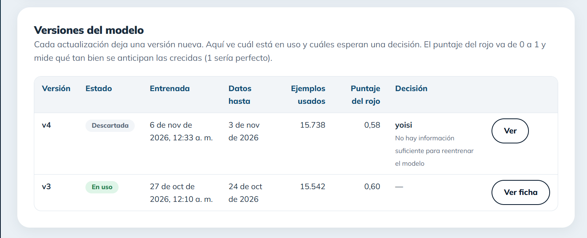

---

## 10. Reportes

Los reportes son páginas HTML autocontenidas (con sus estilos y gráficas adentro). Solo dicen lo que se calculó con los datos; las relaciones son asociaciones y nunca causas. Se pueden ver en pantalla, descargar en **PDF** o en **HTML**.

| Reporte (sección 10 del enunciado) | Contenido |
|---|---|
| **Análisis de los datos (EDA)** | Resumen del conjunto de datos, calidad de los datos, estadísticas, visualizaciones y observaciones generadas por el sistema |
| **Compatibilidad** | Columnas esperadas y recibidas, tipos de datos, advertencias, errores y estado final del archivo |
| **Predicciones** | Resumen general, semáforo más reciente de cada estación, resumen por estación y las 20 horas con mayor probabilidad de rojo. Todas las predicciones, con identificación de cada registro y probabilidad, se descargan en CSV |
| **Actualización del modelo** | Descripción de los datos nuevos, comparación entre la versión anterior y la candidata, métricas, recomendación del sistema y decisión registrada |

**Dónde se generan**

- **Reportes y descargas** (menú lateral): los reportes de los **datos publicados** o de cualquier **lote**, y el de actualización del modelo (versión nueva frente a otra, por defecto la que está en uso). El reporte se ve en la misma página, con los botones **Descargar PDF**, **Descargar HTML** y, en predicciones, **Todas las predicciones (CSV)**.
- **Cargar archivos → Reportes para descargar:** los reportes de compatibilidad, análisis y predicciones de un archivo que se acaba de elegir.
- **Actualizar el modelo → Comparar y decidir:** botón «Descargar el reporte de actualización».

Este mismo módulo agrupa las **descargas**: los datos publicados (CSV, con filtro por estación y periodo) y los lotes de datos nuevos (CSV).

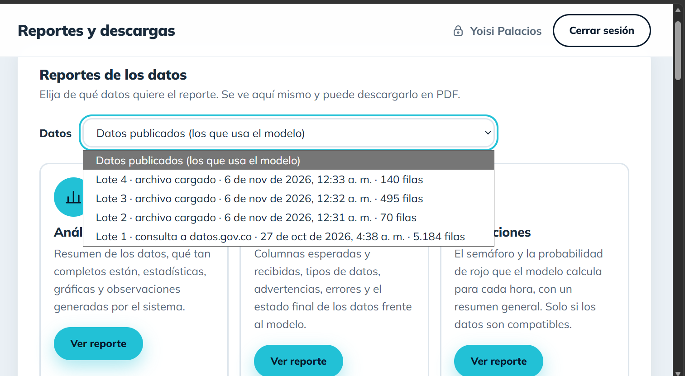
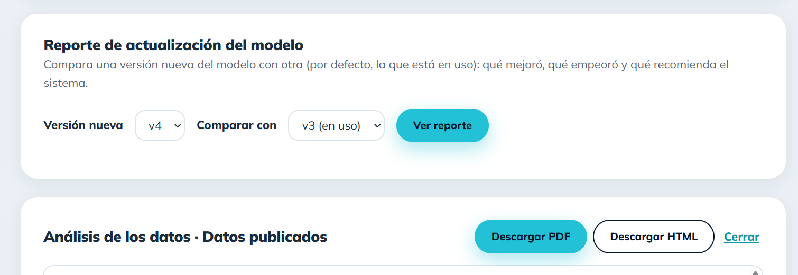
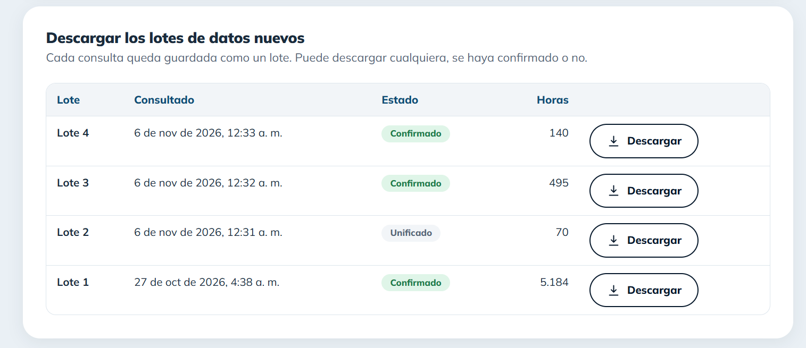

**Cómo se genera el PDF.** Se arma en el navegador a partir del reporte que se ve en pantalla (con las librerías `html2canvas` y `jsPDF`, que el navegador descarga solo la primera vez que se pide un PDF). Por eso necesita conexión a internet; el reporte en HTML no.

**Auditoría.** Cada descarga de un reporte queda registrada en **Actividad** con quién la hizo y de qué datos (por ejemplo, «11.439 filas · Reporte de análisis de los datos»).

**Evidencia de los reportes.** Los reportes generados con los datos reales del sistema están en `pruebas/reportes/` (en PDF): análisis de los datos, predicciones y actualización del modelo (v4 frente a v3). Para generar más: en **Reportes y descargas**, elegir los datos, pulsar **Ver reporte** y **Descargar PDF**; los archivos de la sección 13 permiten sacar un reporte de compatibilidad y uno de predicciones por escenario.

---

## 11. API

La API está hecha con **FastAPI** y se documenta sola: abrir `http://127.0.0.1:8000/docs` para ver y probar cada operación. Los errores se devuelven como un mensaje comprensible con un código (por ejemplo `ARCHIVO_INCOMPATIBLE`), nunca como trazas técnicas.

**Operaciones mínimas del enunciado (sección 11)**

| Operación | Método y ruta | Función |
|---|---|---|
| Analizar dataset | `POST /admin/analizar` | Recibe un archivo y genera el EDA |
| Validar compatibilidad | `POST /admin/validar` | Compara el archivo con el esquema del modelo |
| Generar predicciones | `POST /admin/predecir` | Ejecuta el pipeline solo sobre datos compatibles (422 si no lo son); `formato=csv` descarga todas |
| Consultar modelo activo | `GET /modelo/activo` | Metadatos y versión actual |
| Actualizar/reentrenar | `POST /admin/modelo/actualizar` | Lanza la actualización en segundo plano y genera una versión candidata |
| Generar/descargar reporte | `POST /admin/reportes/{compatibilidad, eda, predicciones}` (con archivo), `GET /admin/reportes/{tipo}` (datos publicados o lote) y `GET /admin/reportes/actualizacion` | Entrega el reporte correspondiente |

**Rutas públicas** (sin sesión): `GET /salud`, `GET /estaciones`, `GET /estaciones/{codigo}`, `GET /modelo/activo` y `GET /descargas/datos.csv`.

**Rutas de administrador** (requieren sesión, prefijo `/admin`): archivos (`/archivos`), lotes (`/lotes`, `/lotes/{id}`, `/confirmar`, `/rechazar`, descargas y marcas), consulta a datos.gov.co (`/consulta/ejecutar`), modelo (`/modelo/versiones`, `/modelo/sugerencia`, `/modelo/actualizacion`, `/modelo/versiones/{version}/activar` y `/descartar`), `/actividad` y `/administradores`.

**Tamaños y formatos:** CSV y Excel (`.csv`, `.xlsx`); hasta 12 archivos a la vez; 60 MB por archivo (400 MB para archivos crudos de datos.gov.co).

---

## 12. Seguridad y trazabilidad

| Aspecto | Cómo se resuelve |
|---|---|
| Claves | Nunca se guardan en texto: solo su resumen cifrado (PBKDF2, 200.000 iteraciones) con una sal propia de cada persona |
| Primer ingreso | La clave inicial se genera al azar, se muestra una sola vez y debe cambiarse al entrar (mínimo 8 caracteres) |
| Bloqueo | Tras 5 intentos fallidos, la cuenta se bloquea 5 minutos; otro administrador puede desbloquearla |
| Sesiones | Duran 8 horas; se guarda solo la huella (SHA-256) del token |
| Restablecer clave | Otro administrador genera una clave temporal; nadie puede restablecer la suya |
| Auditoría | Cada ingreso, descarga y cambio de datos queda con el nombre de quien lo hizo. Solo se agregan registros: **no se editan ni se borran desde la API** |
| Datos incompatibles | Nunca se modifican en silencio |
| Hora | Siempre la de Colombia, corra donde corra el servidor |

La actividad se puede filtrar por persona y por acción (ingresó, analizó un archivo, confirmó un lote, consultó datos.gov.co, descargó un lote, descargó un reporte, inició la actualización del modelo, descartó una versión, cambió su clave, intento de ingreso fallido, entre otras). El usuario `sistema` registra lo que hace el propio sistema.

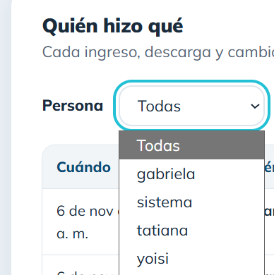
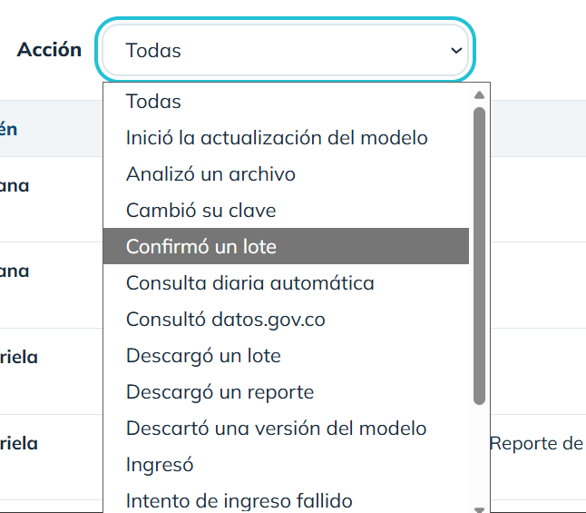

---

## 13. Pruebas

### 13.1 Archivos de prueba

Están en `pruebas/archivos/`. Los archivos 1 a 7 salen de datos reales del repositorio alterados **de una sola manera cada uno**; el 8 son datos reales nuevos consultados a datos.gov.co. El script `pruebas/generar_archivos.py` los regenera (`python pruebas/generar_archivos.py`, y con `--nuevos` también el 8, que necesita internet).

| # | Archivo | Escenario del enunciado | Cómo se preparó |
|---|---|---|---|
| 1 | `01_compatible.csv` | Totalmente compatible, permite predecir | Tramo real de la estación Quibdó: 1.200 horas seguidas con nivel y lluvia en todas |
| 2 | `02_falta_variable_lluvia_mm.csv` | Falta una variable obligatoria | Al archivo 1 se le quitó la columna `lluvia_mm` |
| 3 | `03_tipos_incompatibles.csv` | Tipos de dato incompatibles | Texto en `nivel_m` en 30 filas y 5 fechas ilegibles |
| 4 | `04_valores_faltantes_en_nivel.csv` | Faltantes en una variable necesaria | 30 % de `nivel_m` vacío, en bloques de 12 horas |
| 5 | `05_estacion_desconocida.csv` | Categoría no vista en el entrenamiento | 120 filas con la estación `0099999999` |
| 6 | `06_columnas_adicionales.csv` | Columnas que el modelo no usa | Se agregaron `municipio`, `operador` y `observacion` |
| 7 | `07_solo_para_eda_emergencias.csv` | No sirve para predecir, pero sí para el EDA | Emergencias reales de la UNGRD (otro tema y otras columnas), 144 filas y 8 columnas |
| 8 | `08_nuevos_datos_reales.csv` | Nuevos datos para el flujo de actualización | 706 horas reales, del 26 de octubre al 4 de noviembre de 2026, de El Siete, Belén y Río Iró, preparadas con la misma lógica del sistema |

### 13.2 Prueba completa paso a paso

1. **Iniciar** MySQL, la API y la interfaz (sección 4) y entrar al panel con un usuario administrador.
2. **Archivo compatible.** En **Cargar archivos**, elegir `pruebas/archivos/01_compatible.csv` y pulsar **Revisar archivos**: debe salir en verde.
3. **EDA.** Pulsar **Analizar un archivo**: se ven el resumen, la calidad de los datos, las estadísticas y las gráficas.
4. **Reportes del archivo.** En «Reportes para descargar», descargar el **reporte de compatibilidad** y el **reporte de predicciones** y abrirlos en el navegador.
5. **Archivo incompatible.** Quitar el archivo, elegir `02_falta_variable_lluvia_mm.csv` y pulsar **Revisar archivos**: sale en rojo y explica la columna que falta. Al pedir el reporte de predicciones, el sistema lo bloquea y sugiere revisar el de compatibilidad.
6. **Resto de escenarios.** Repetir el paso con los archivos 03 a 07 (resultados en 13.3). Con el 07, usar también **Analizar un archivo** para comprobar que el EDA funciona aunque el archivo no sirva para predecir.
7. **Datos nuevos.** En **Datos nuevos**, pulsar **Consultar ahora**. Abrir el lote que se crea, revisar sus datos diarios, las lecturas marcadas y la recomendación, y **confirmarlo**.
8. **Actualizar el modelo.** Leer «¿Conviene actualizar el modelo?», pulsar **Actualizar el modelo** (o **Entrenar de todos modos**) y esperar a que termine la barra de avance.
9. **Comparar y decidir.** En la tabla de versiones, abrir la candidata con **Comparar y decidir**: ver las métricas frente a la versión en uso, descargar el reporte de actualización y decidir con una justificación escrita.
10. **Reportes y descargas.** Ver los reportes de los datos publicados y de un lote, y descargar uno en **PDF**.
11. **Actividad.** Revisar que todo lo anterior quedó registrado con el nombre de quien lo hizo.
12. **API.** Abrir `http://127.0.0.1:8000/docs` y probar `GET /modelo/activo`.

### 13.3 Resultados de los escenarios (tal como salieron)

Todas las pruebas se hicieron en **Cargar archivos → Revisar archivos**, con la base de datos local.

| # | Resultado observado | ¿Coincide con lo esperado? |
|---|---|---|
| 1 | Verde: «Los archivos sirven». 1.200 lecturas útiles de 1.200 (20 de marzo a 8 de mayo de 2026), estación Quibdó. «El archivo está bien.» | Sí |
| 2 | Rojo: «Hay archivos con errores. No se creó el lote». Error: «Falta la columna obligatoria 'lluvia_mm'». | Sí |
| 3 | Rojo. Errores: «'fecha_hora' debe ser una fecha y hora con formato AAAA-MM-DD HH:MM:SS; 5 filas no se pudieron leer así» y «'nivel_m' debe ser un número y 30 filas traen texto u otro formato». Advertencia: faltan 5 horas | Sí |
| 4 | Aviso general en verde y el archivo en amarillo. Advertencia: «'nivel_m' tiene 360 valores vacíos (30,0 %). El modelo los trata como dato faltante, pero las predicciones de esas horas pueden ser menos confiables» | Sí: es advertencia porque el esquema admite vacíos en `nivel_m` |
| 5 | Rojo. Error: «'estacion' trae valores que el modelo no conoce: 0099999999. El sistema no los reemplaza ni los ignora». Advertencia: faltan 120 horas | Sí |
| 6 | Aviso general en verde y el archivo en amarillo. Advertencia: «El archivo trae 3 columnas que el modelo no usa y se ignorarán: municipio, operador, observacion» | Sí |
| 7 | Rojo. «No se reconoce el formato. Se esperaban las columnas de datos.gov.co (…) o las del archivo combinado (…). Columnas encontradas: fecha, municipio, evento, fallecidos, heridos, personas, familias, viviendas_destruidas» | Sí, con una precisión: en este flujo el archivo se rechaza en el reconocimiento del formato, antes de compararlo con el esquema del modelo. El EDA sí es posible con **Analizar un archivo** |
| 8 | Aviso general en verde y el archivo en amarillo. 706 lecturas útiles de 706 (26 de octubre a 4 de noviembre de 2026), estaciones El Siete, Belén y Río Iró. Advertencia: faltan 14 horas entre la primera y la última de cada estación (0011027030: 11 h, 0054027050: 3 h) | Sí |

**Capturas**

| 1. Compatible | 2. Falta una variable |
|---|---|
| 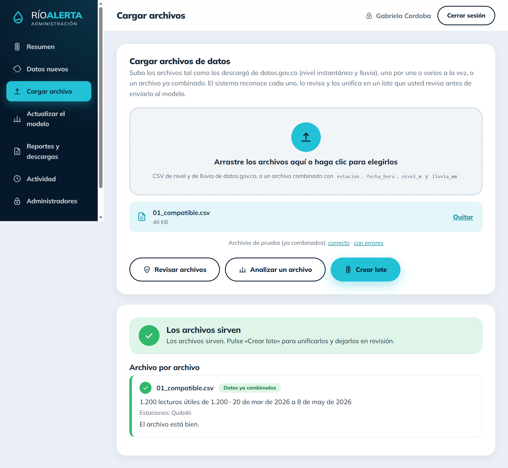 | 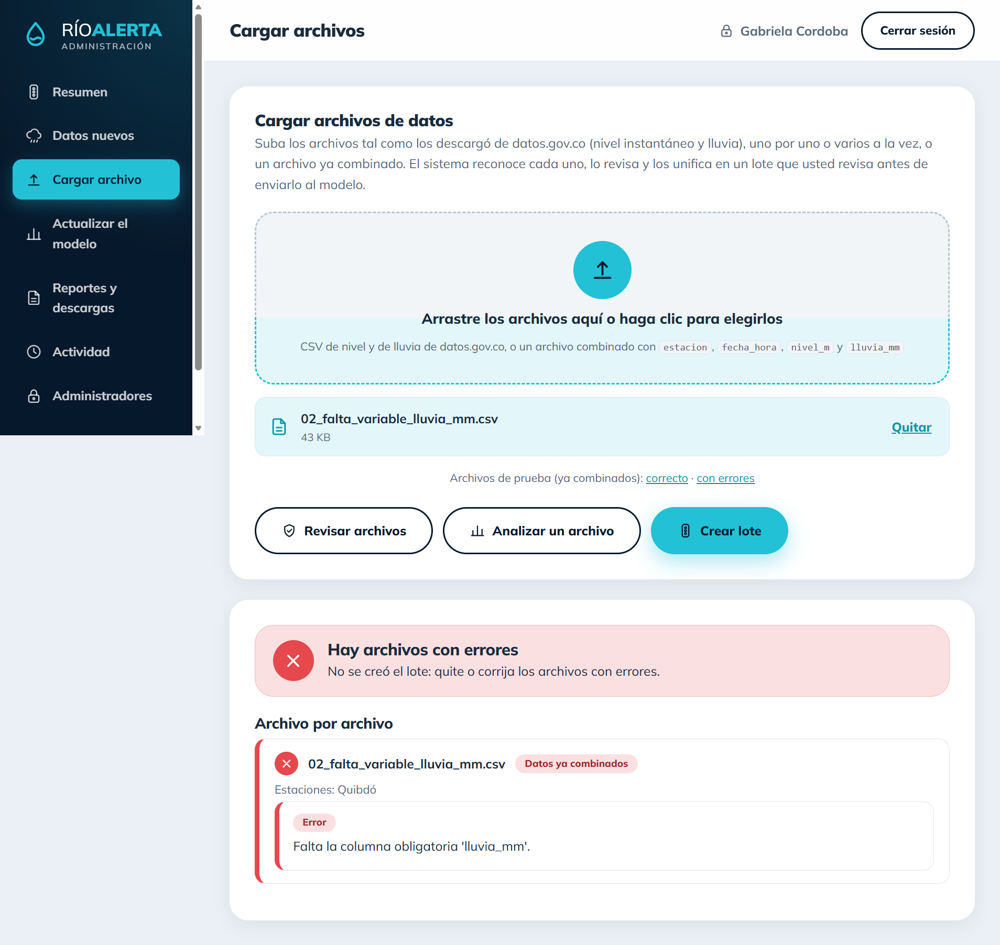 |

| 3. Tipos incompatibles | 4. Valores faltantes |
|---|---|
| 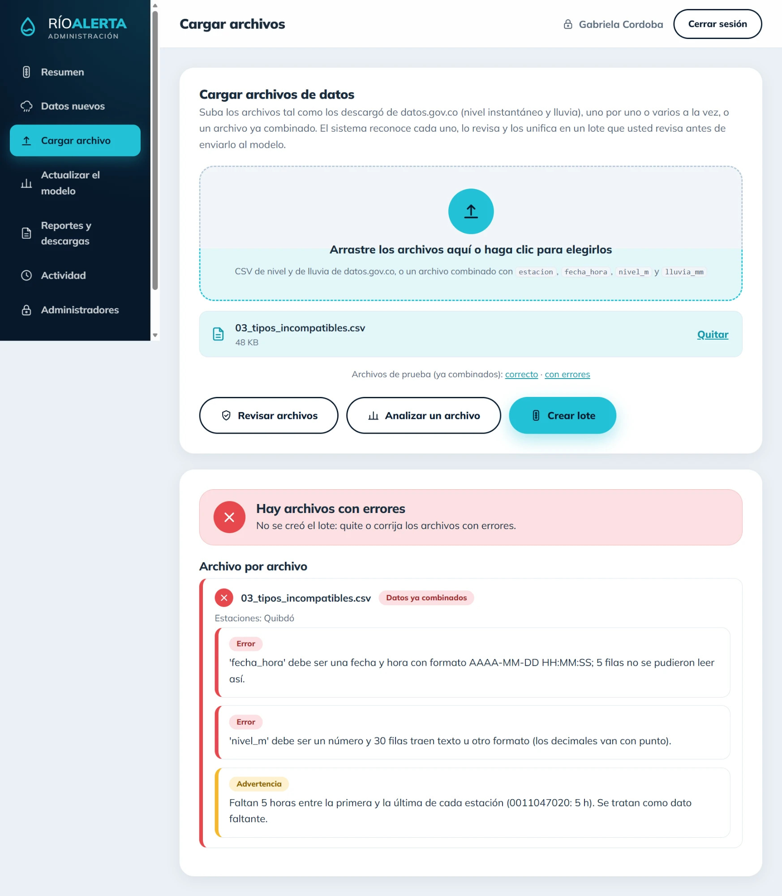 | 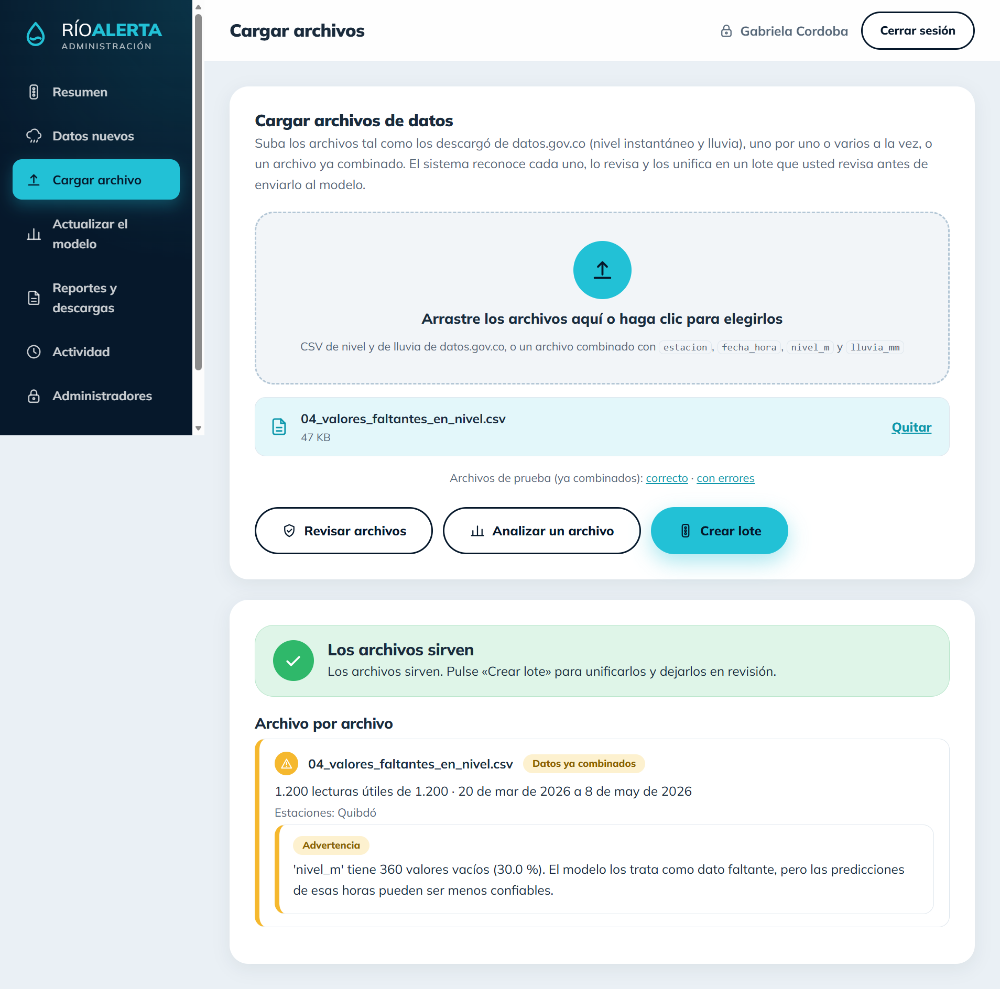 |

| 5. Estación desconocida | 6. Columnas adicionales |
|---|---|
| 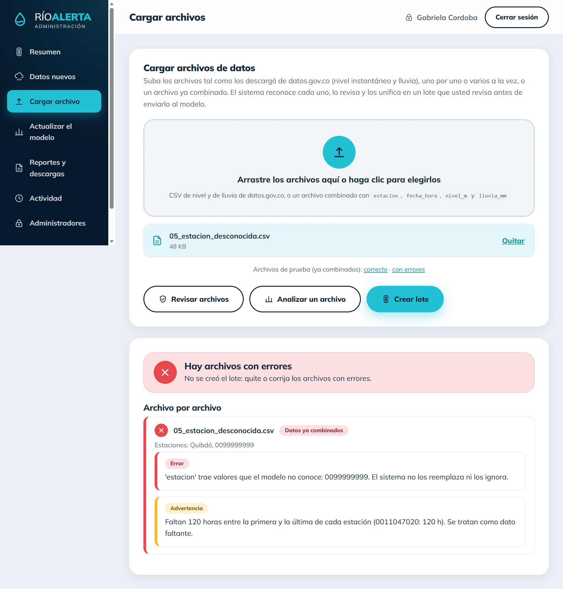 | 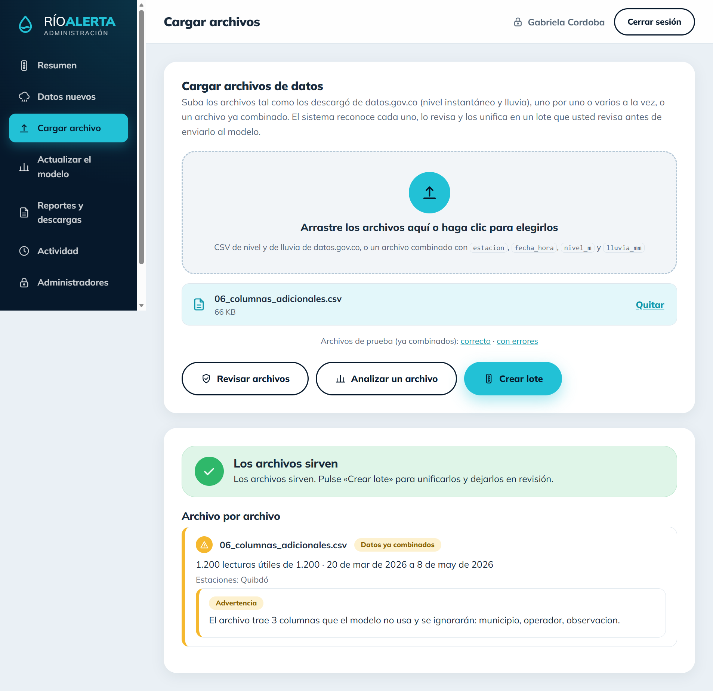 |

| 7. Solo para EDA | 8. Nuevos datos reales |
|---|---|
| 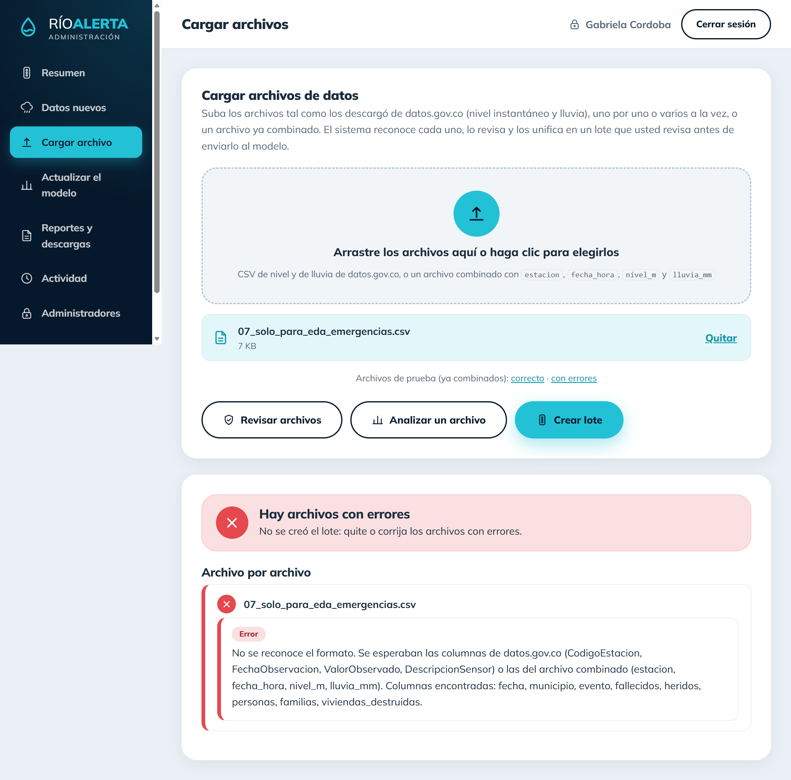 | 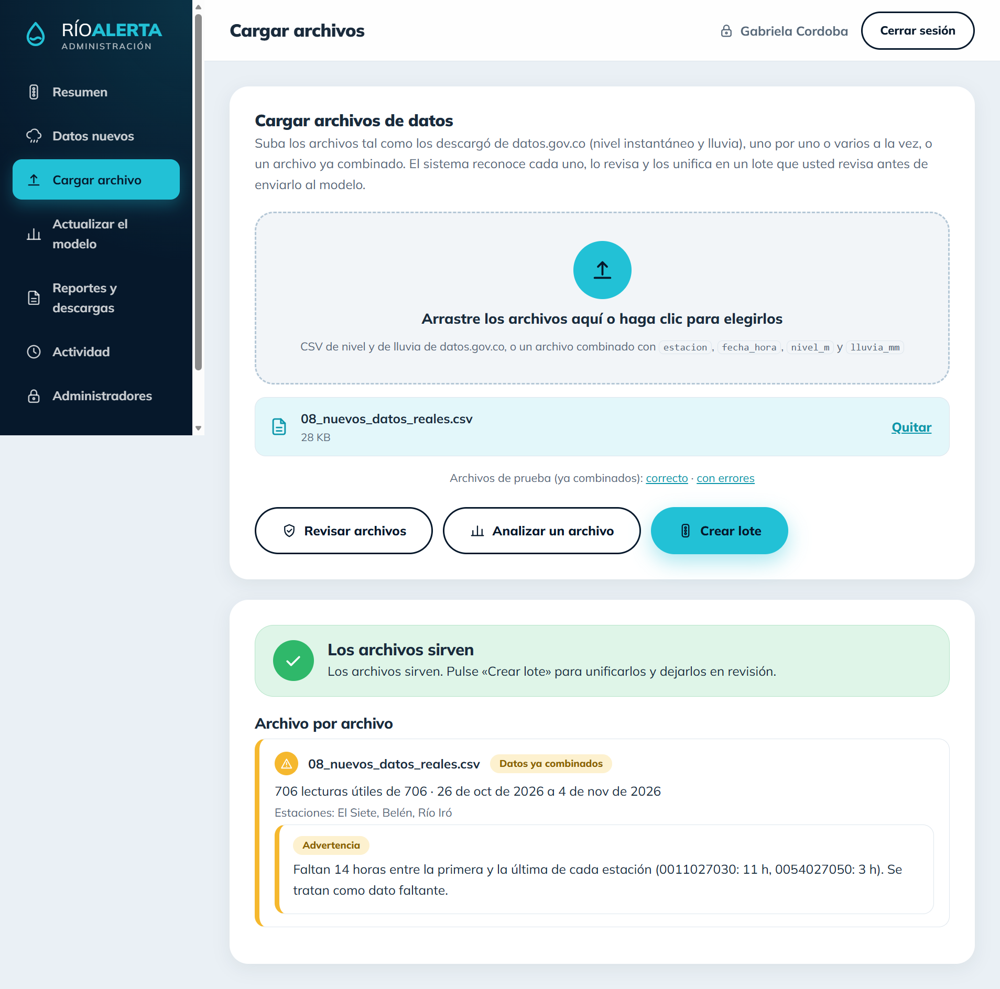 |

**Observaciones de las pruebas**

- En los escenarios 4, 6 y 8 el mensaje general dice «Los archivos sirven» (verde) y el detalle del archivo aparece en amarillo con su advertencia: el archivo se puede procesar, pero el usuario debe conocer la situación.
- Todos los archivos incompatibles muestran el mensaje «No se creó el lote: quite o corrija los archivos con errores»: el sistema no deja avanzar un archivo con errores.
- El escenario 8 se probó con `08_nuevos_datos_reales.csv` solo en la revisión. Esos datos ya estaban en la base de pruebas (lotes 3 y 4), por lo que crear un lote con ese archivo solo dice «No hay nada nuevo». El flujo de actualización se probó con los lotes ya confirmados (sección 13.4); el archivo 08 está pensado para una instalación nueva, cuya base solo llega al 24 de octubre de 2026.
- La demostración de la predicción bloqueada con un archivo incompatible y el EDA del archivo 07 se verificaron con el código (el validador marca incompatible el archivo 07 por faltar las 4 columnas, y el EDA lo analiza con 144 filas y 4 gráficas), pero **no tienen captura de pantalla**.

### 13.4 Resultados del flujo de actualización del modelo (escenario 8)

**Datos nuevos.** Cuatro lotes en la base de pruebas:

| Lote | Origen | Estado | Horas | Periodo |
|---|---|---|---|---|
| 1 | datos.gov.co | Confirmado | 5.184 | 3 de julio a 24 de octubre de 2026 |
| 2 | Archivos subidos | Unificado (sus datos pasaron a un lote más nuevo) | 70 | 26 de octubre de 2026 |
| 3 | Archivos subidos | Confirmado | 495 | 26 de octubre a 1 de noviembre de 2026 |
| 4 | Archivos subidos | Confirmado | 140 | 2 a 3 de noviembre de 2026 |


**Consejo del sistema** («¿Conviene actualizar el modelo?»), mirando lo guardado desde el 24 de octubre de 2026:

- 635 horas nuevas con nivel (unos 10 días), 189 ejemplos nuevos (1,2 % de los que ya usó el modelo), 3 lotes confirmados y 16 horas en rojo.
- Conclusión: **«Todavía no hace falta»**: hay muy poca información nueva; conviene que llegue al 5 % como mínimo.
- Razones: «Quibdó no ha enviado datos nuevos desde el último entrenamiento» (con cuidado); «3 de 4 estaciones traen nivel en más del 60 % de las horas: Belén, El Siete, Río Iró» (a favor); solo hubo 16 horas en rojo en los datos nuevos; vienen de 3 lotes confirmados.


**Versión candidata y decisión.** Aun con el consejo de esperar, se entrenó una versión candidata para probar el flujo completo:

| Versión | Estado | Entrenada | Datos hasta | Ejemplos | Puntaje del rojo (F1) | Decisión |
|---|---|---|---|---|---|---|
| v4 | Descartada | 6 de noviembre de 2026, 12:33 a. m. | 3 de noviembre de 2026 | 15.738 | **0,58** | yoisi: «No hay información suficiente para reentrenar el modelo» |
| v3 | En uso | 27 de octubre de 2026, 12:10 a. m. | 24 de octubre de 2026 | 15.542 | **0,60** | — |

**Resultado:** la versión nueva (0,58) **no mejoró** a la que está en uso (0,60); con solo 10 días de datos nuevos la diferencia es casualidad. El sistema conservó ambas versiones, mostró la comparación y la decisión de **descartar v4** quedó registrada con su autor y su justificación. La versión v3 sigue en uso. Esto demuestra que el sistema no sustituye el modelo automáticamente.


### 13.5 Trazabilidad registrada

El módulo **Actividad** muestra lo que se hizo durante las pruebas: ingresos y cierres de sesión, cambio de clave, y la descarga de un reporte de análisis de 11.439 filas por una administradora.


---

## 14. Despliegue

El sistema se publica en cuatro piezas gratuitas:

| Pieza | Servicio | Qué aloja |
|---|---|---|
| API | Render | `backend/` (FastAPI) |
| Base de datos | TiDB Cloud (compatible con MySQL) | Usuarios, sesiones, auditoría, lotes, lecturas publicadas y versiones del modelo |
| Sitio web | Cloudflare | `interfaz/` (sitio estático, sin paso de construcción) |
| Mantenerla activa | GitHub Actions y UptimeRobot | Visitan `/salud` para que Render no duerma el servicio |

**Pasos**

1. **Base de datos en la nube.** Crear la base en TiDB Cloud y anotar host, puerto, usuario, clave y nombre.
2. **Pasar lo local a la nube** (una vez), con las variables de la base local y las de destino con el prefijo `DESTINO_BD_` (incluido `DESTINO_BD_SSL=si`), desde `backend`:

   ```bash
   python migrar_base.py
   ```

   Se puede repetir sin problema: lo que ya estaba en el destino se reemplaza.
3. **API en Render.** Servicio web con la carpeta `backend`:
   - Instalar: `pip install -r requirements.txt`
   - Iniciar: `uvicorn api:app --host 0.0.0.0 --port $PORT`
   - Variables de entorno: `SEMAFORO_BD_HOST`, `SEMAFORO_BD_PUERTO`, `SEMAFORO_BD_USUARIO`, `SEMAFORO_BD_CLAVE`, `SEMAFORO_BD_NOMBRE`, `SEMAFORO_BD_SSL=si` y `SEMAFORO_ORIGENES` con la dirección del sitio web publicado.
4. **Sitio web.** Publicar la carpeta `interfaz` en Cloudflare. El archivo `interfaz/js/config.js` usa la API local cuando la página se abre desde `localhost` y la API publicada (`https://rio-alerta-api.onrender.com`) en cualquier otra dirección.
5. **Mantenerla activa.** Render duerme el servicio gratuito tras 15 minutos sin visitas. El flujo `.github/workflows/mantener_activo.yml` visita `/salud` cada 10 minutos (usa el secreto `URL_API` del repositorio). UptimeRobot hace lo mismo como respaldo.
6. **Administradores en la nube.** Se crean con `python usuarios.py crear usuario "Nombre Apellido"` apuntando a la base de la nube.

Las tablas y columnas nuevas se crean solas al iniciar la API.

---

## 15. Decisiones de arquitectura

| Decisión | Por qué |
|---|---|
| Las reglas de validación viven en los metadatos del modelo | El enunciado no acepta reglas dispersas solo en la interfaz. Cada versión trae su esquema, y validar un archivo nunca depende de un valor escrito en el código |
| Validación en capas (formato, esquema, tipo, contenido, dominio) con códigos de regla | Cada problema se explica con la variable, lo esperado, lo encontrado y las filas afectadas |
| El sistema nunca corrige datos en silencio | Corregir para forzar una predicción ocultaría problemas reales; el usuario corrige y vuelve a validar |
| Predicción bloqueada si el archivo es incompatible (422) | Garantiza que el modelo solo se use bajo las condiciones con las que se construyó |
| El EDA se ejecuta con cualquier archivo y decide qué calcular según los tipos | Permite estudiar un archivo antes de corregirlo; no es una plantilla fija |
| Bosque aleatorio con el percentil como regla de color | Modelo explicable, se compara con reglas simples y se valida por bloques de tiempo, sin mirar el futuro |
| El pipeline reutiliza el mismo código de variables del entrenamiento | La versión nueva y la que está en uso ven los datos igual; no se reajusta nada al predecir |
| Los datos nuevos pasan por lotes que una persona confirma | La consulta y la carga de archivos nunca publican ni reentrenan por sí solas |
| Todo lo recibido se conserva; el semáforo usa los últimos 120 días | No se pierde información, y el cálculo sigue siendo rápido |
| Las versiones del modelo viven en la base de datos | El disco de los servidores gratuitos se borra al reiniciar |
| La actualización no sustituye el modelo: decide una persona con justificación | Exigido por el enunciado, y evita reemplazarlo por una versión que no mejora (caso real de v4) |
| Reportes HTML autocontenidos y PDF generado en el navegador | No hace falta instalar librerías de PDF en el servidor; el HTML funciona sin conexión |
| Reportes con observaciones calculadas, sin afirmaciones causales | Condición del enunciado: las asociaciones no se presentan como causas |
| Auditoría que solo se agrega | Trazabilidad: quién hizo qué y cuándo, sin posibilidad de editarlo |
| Hora de Colombia en todo el sistema | El servidor en la nube trabaja en UTC; evita registros con hora corrida |

---

## 16. Limitaciones conocidas

- **Estación Quibdó sin datos recientes.** Su última lectura es del 4 de julio de 2026 (en el Resumen aparece «hace 125 días» y «No recientes»). Su semáforo no es vigente, y esa es la razón por la que el sistema avisa «Quibdó no ha enviado datos nuevos».
- **Alcance del modelo.** Puntaje del rojo de 0,60: en la validación detectó cerca de la mitad de las crecidas (0,502) y acertó el 73,5 % de sus alertas rojas. Es una ayuda para anticiparse, no una certeza.
- **Solo 4 estaciones.** Una estación desconocida se rechaza; el sistema no extrapola a otras.
- **Pocos eventos en rojo.** El rojo se define como el percentil 95: por definición, el 5 % de las horas. Reentrenar con pocos días de datos nuevos no mejora el modelo (caso v4: 0,58 frente a 0,60).
- **Calidad de los datos del IDEAM.** Los datos son preliminares y tienen huecos y picos aislados. El sistema excluye lo imposible, marca lo dudoso con su justificación y trata las horas ausentes como datos faltantes.
- **Historia mínima.** Se necesitan 168 horas previas por estación; las primeras horas de un archivo quedan «sin historia suficiente».
- **Reporte de predicciones.** Muestra las 20 horas con mayor probabilidad de rojo; el detalle completo está en el CSV.
- **EDA con muestra.** Sobre 100.000 filas, las gráficas y correlaciones usan una muestra.
- **PDF.** Se genera en el navegador y requiere conexión a internet la primera vez; sin ella se descarga el HTML.
- **Servicios gratuitos.** Render puede tardar en despertar y la base en la nube tiene límites. Una actualización del modelo en curso se pierde si el servidor se reinicia (se puede lanzar de nuevo).
- **Una actualización a la vez.** El entrenamiento corre en segundo plano en la misma instancia de la API.
- **Datos de prueba locales.** Las pruebas se hicieron en una base de datos local; no se probó una instalación nueva con el archivo 08 como datos nuevos.

---

## 17. Equipo y trazabilidad del repositorio

| Persona | Aporte |
|---|---|
| Yoisi Palacios | API, validación, EDA, pipeline, ingesta de datos nuevos, interfaz y panel, administradores, despliegue |
| Tatiana Serna | Reentrenamiento del modelo (lectura de datos, variables y métricas, versión candidata y su comparación), vista del reentrenamiento y README inicial |
| Gabriela Cordoba | Reportes: compatibilidad, análisis (EDA), predicciones y actualización del modelo; rutas de la API y módulo «Reportes y descargas» de la interfaz |

Cada persona aporta con commits y ramas propias en GitHub (`https://github.com/PalaciosYoisi/proyecto_final`), con un Pull Request por rama:

- Reentrenamiento: ramas fusionadas mediante los Pull Requests 2 a 5.
- Reportes: ramas `reportes-backend` (5 commits: un reporte por commit y las rutas de la API) y `reportes-interfaz` (3 commits: el módulo, su conexión al panel y los botones en otras vistas).

---

## 18. Dónde se cumple cada requisito del enunciado

| Requisito | Dónde se cumple |
|---|---|
| Cargar CSV y, opcionalmente, Excel | Cargar archivos (sección 5); `.csv` y `.xlsx` |
| API con FastAPI | Sección 11 |
| Separar el EDA general de la ejecución del modelo | `eda.py` frente a `pipeline.py`; el EDA no exige compatibilidad |
| Validar estructura, tipos y reglas antes de predecir | Sección 6 |
| Informar las incompatibilidades de forma comprensible | Sección 6 y escenarios 2 a 5 (sección 13) |
| Reportes descargables de EDA, compatibilidad y predicciones | Sección 10 |
| Actualizar, reentrenar y comparar antes de sustituir | Sección 9 |
| Estados compatible, con advertencias e incompatible | Sección 6; escenarios 1, 4, 6 y 2 (sección 13) |
| Esquema y metadatos del modelo | Sección 6 (`modelos/v3/metadatos.json`) |
| EDA automático según los tipos de variable | Sección 7 |
| Predicción con el mismo pipeline, sin reajustar transformadores | Sección 8 |
| Manejo de incompatibilidades, sin corrección silenciosa | Sección 6 |
| Versionamiento mínimo del modelo | Sección 9 |
| Reportes automáticos (4) | Sección 10 |
| API mínima | Sección 11 |
| Pruebas mínimas obligatorias (8 escenarios) | Sección 13 |
| Modelo persistido, sin entrenar en cada predicción | Sección 8 |
| Errores sin trazas técnicas | Sección 11 |
| Trazabilidad entre versiones | Sección 9 |
| Código fuente, modelo y metadatos | Secciones 3 y 6 |
| README con instalación, ejecución y prueba completa | README del repositorio y secciones 4 y 13.2 |
| Diagrama de arquitectura | Sección 2 y `docs/diagrama_arquitectura.png` |
| Conjunto de archivos de prueba | `pruebas/archivos/` (sección 13.1) |
| Evidencia de reportes | `pruebas/reportes/` y sección 10 |
